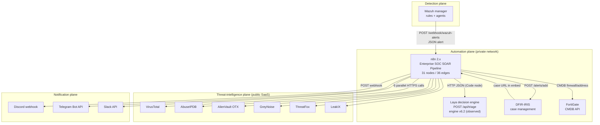
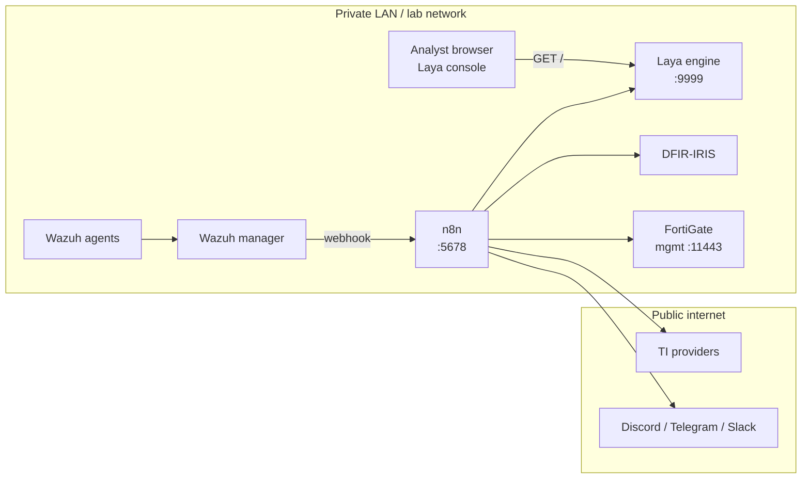
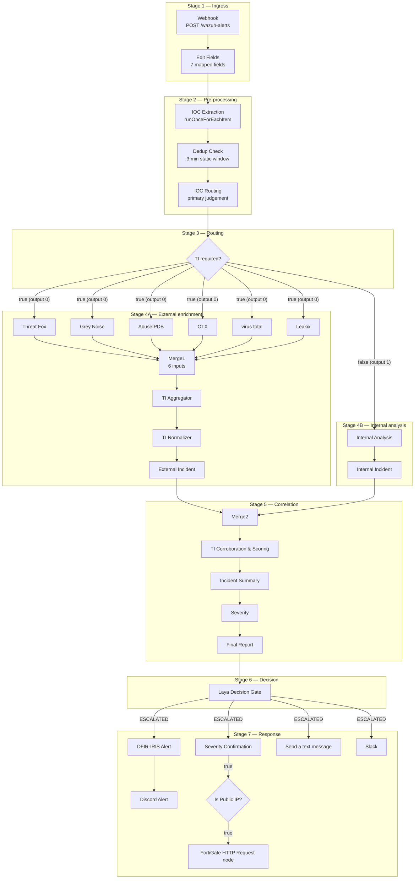
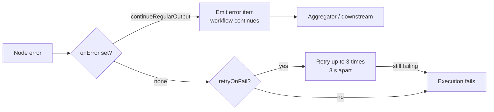
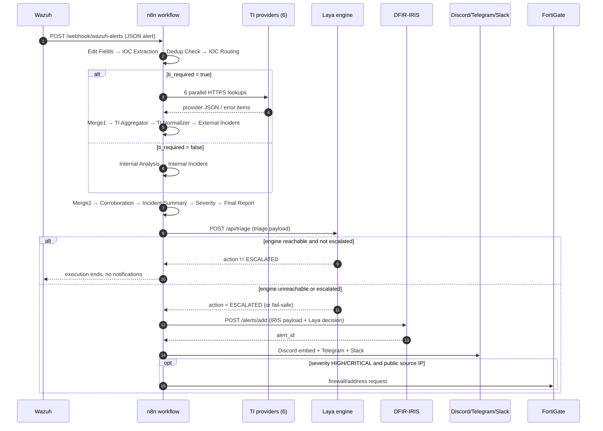
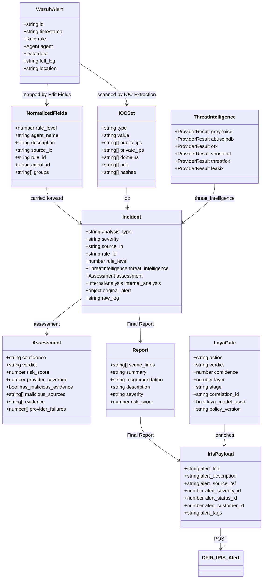
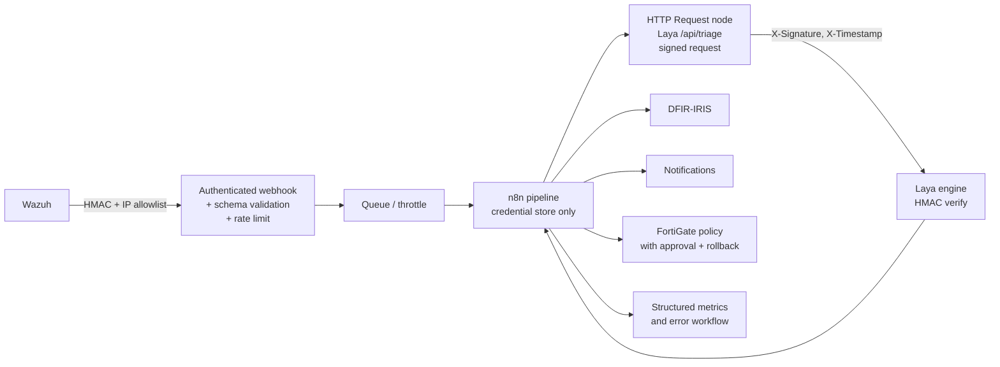

# 02 — System Architecture

| Item | Value |
|---|---|
| Document | System architecture |
| Version | 1.0 |
| Date | 2026-11-10 |
| Basis | Static analysis of the sanitized 31-node workflow export |

---

## 1. Architectural style

The system is an **event-driven orchestration pipeline** implemented as a single n8n
workflow. It is not a microservices application. There is no application database owned
by this project, no queue service, and no separately deployed worker. The n8n instance
is the orchestrator, the ephemeral execution context is the state container, and external
systems are reached over HTTP.

```text
┌─────────────────────┐
│  Event producer      │  Wazuh manager
│  (untrusted input)   │
└──────────┬──────────┘
           │ HTTPS POST
           ▼
┌─────────────────────┐
│  Orchestrator        │  n8n workflow (31 nodes)
│  (trusted compute)   │  ephemeral execution data
└──────────┬──────────┘
           │ HTTPS / HTTP
           ▼
┌───────────────────────────────────────────────┐
│  External systems                             │
│  TI providers · Laya engine · DFIR-IRIS        │
│  Discord · Telegram · Slack · FortiGate        │
└───────────────────────────────────────────────┘
```

The architecture has three distinguishing properties:

1. **Deterministic first, authoritative decision last.** All enrichment and scoring is
   deterministic JavaScript. The final gate delegates to a separate decision engine.
2. **Branch and merge.** A single IF node splits external and internal analysis. Two
   Merge nodes rejoin fan-outs.
3. **Fail-open escalation.** If the decision engine is unreachable, the workflow escalates
   rather than dropping the alert.

---

## 2. System context



**Trust boundaries:**

| Boundary | Crossed by | Control observed |
|---|---|---|
| Internet → Wazuh | Agent events | Wazuh agent registration (not in export) |
| Wazuh → n8n | Webhook POST | **None configured** |
| n8n → TI SaaS | Six credentialed HTTPS calls | API keys in headers |
| n8n → Laya | Unauthenticated HTTP JSON | **None observed** |
| n8n → IRIS/FortiGate | Bearer tokens | TLS verification explicitly disabled |
| n8n → chat platforms | Credential + webhook/token | Provider credentials |

The two weakest boundaries are the inbound webhook and the Laya call. See
[14 — Security](14-security.md).

---

## 3. Deployment topology



Observed service facts (read-only probes, no credentials used):

| Service | Observed value | Notes |
|---|---|---|
| Laya console title | `Laya - SOC Decision Console` | HTML SPA at port 9999 |
| Laya health | `engine: online`, `engine_version: 6.2`, `model: convaiinnovations/laya`, `online` | `GET /api/health` |
| Laya stats | `total_triaged`, `suppressed`, `escalated`, `tp`, `fp`, `tn`, `fn_prevented`, latency metrics | `GET /api/stats` |
| HTTP server header | `Laya-Triage/5.1` | Not evidence of HMAC |
| `/api/triage` | `404` on GET, `501` on OPTIONS and HEAD | POST was not sent |
| n8n editor | SPA shell only | `/rest/...` and `/api/v1/...` returned `401` |
| n8n version | 2.40.5 (from export metadata) | `authCookie.secure=false` in raw export |

No HMAC headers, signing keys, nonce parameters or signature verification were observed
in the console HTML, the health/stats responses, or the workflow export.

---

## 4. Internal architecture: pipeline stages



### Stage responsibilities

| Stage | Nodes | Responsibility | Output contract |
|---|---|---|---|
| 1. Ingress | Webhook, Edit Fields | Accept and normalise the Wazuh alert | Flat fields + original `body` |
| 2. Pre-processing | IOC Extraction, Dedup Check, IOC Routing | Find IOCs, suppress duplicates, decide TI eligibility | `ioc`, `ti_required`, `source_ip`, `laya_primary` |
| 3. Routing | TI required? | Split external and internal paths | Two IF outputs |
| 4A. External | 6 HTTP nodes, Merge1, TI Aggregator, TI Normalizer, External Incident | Enrich and aggregate | `{ incident: {...} }` with `analysis_type: external` |
| 4B. Internal | Internal Analysis, Internal Incident | Extract host telemetry | `{ incident: {...} }` with `analysis_type: internal` |
| 5. Correlation | Merge2, Corroboration, Incident Summary, Severity, Final Report | Corroborate, score, report | `{ report, severity, iris_payload }` |
| 6. Decision | Laya Decision Gate | Ask the engine for an authoritative verdict | `{ ...data, iris_payload, laya_gate }` or `[]` |
| 7. Response | IRIS, Discord, Telegram, Slack, IFs, FortiGate | Case creation, notifications, containment attempt | HTTP side effects |

---

## 5. Fan-out and fan-in semantics

### 5.1 `TI required?` → six providers → Merge1

The IF node's true output has six connections, one to each provider. All six providers
therefore execute for a single alert. `Merge1` is configured with `numberInputs: 6` and
no other parameters, which means n8n's default **Append** mode is used. The official
Merge node documentation states that Append mode "waits for the execution of all connected
inputs" and outputs each input's items one after another.

Consequences:

- The aggregator receives up to six items, one per provider, rather than one merged object.
- **TI Aggregator** reads `$input.all()` and identifies each provider by the *shape* of
  its response (for example `data.pulse_info` for OTX, `data.data.attributes` for
  VirusTotal). There is no provider name in the item.
- If two providers return a similar shape, the later item overwrites the earlier one.
- `onError: continueRegularOutput` on each provider prevents a single API failure from
  aborting the whole branch. Two nodes (`virus total`, `OTX`) also set
  `alwaysOutputData: true`.

### 5.2 External / internal → Merge2

`Merge2` has the default two inputs and no explicit mode. The external and internal
incident builders both emit `{ incident: ... }`, which is why the downstream Code nodes
can read `data.incident`. Only one branch produces data for a given alert.

> **Runtime verification required.** n8n Merge v3 Append mode waits for all connected
> inputs. The export does not set `alwaysOutputData` on Merge2. Whether the node emits an
> item when only one IF branch executes must be confirmed in the target n8n version. This
> is a design risk, not a confirmed defect; see
> [15 — Limitations](15-limitations-and-roadmap.md) and
> [13 — Troubleshooting](13-troubleshooting.md).

### 5.3 Laya Decision Gate → four response nodes

The gate has four outgoing connections: IRIS, Severity Confirmation, Telegram and Slack.
All four receive the same item. Discord is *not* directly connected to the gate; it runs
after IRIS so it can embed the returned case ID.

---

## 6. Execution modes and state

| Aspect | Production webhook execution | Manual/test execution |
|---|---|---|
| Trigger | External POST to `/webhook/wazuh-alerts` | Editor "Execute workflow" |
| `$getWorkflowStaticData('global')` | Persisted by n8n | Not reliably persisted |
| Dedup effectiveness | Works within the 3-minute window | Effectively bypassed |
| Webhook response | Synchronous, after the full workflow | Editor output |
| Retries | Code nodes retry 3 times, 3 s apart | Same |

The dedup node explicitly bypasses test payloads when `test` is set on the incoming data.
Because static workflow data is only persisted for published workflow executions, the
deduplication guarantee is weaker in test mode and in multi-instance deployments.

**State locations:**

| State | Location | Lifetime |
|---|---|---|
| Current item | n8n execution data | One execution |
| Dedup fingerprints | `$getWorkflowStaticData('global').seenAlerts` | Until deleted by the 3-minute sweep |
| Credentials | n8n credential store / inline headers | Until rotated |
| Execution history | n8n's own database | Per n8n retention settings |
| Case record | DFIR-IRIS | Per IRIS retention settings |
| Decision record | Laya engine | Per engine retention settings |

The workflow itself does not create a database. It does rely on n8n's internal database
for workflow definitions and execution history.

---

## 7. Error-handling architecture



| Node group | Error behaviour | Risk |
|---|---|---|
| Webhook, Edit Fields, IFs, Merges | Default (fail execution) | Provider or expression errors can abort the run |
| Six TI HTTP nodes | `continueRegularOutput`; VT and OTX also `alwaysOutputData` | Error items flow into the aggregator |
| Leakix | `continueRegularOutput` + `retryOnFail: true` (no `maxTries` set) | Retries with unset cap |
| DFIR-IRIS, Discord, Telegram, Slack, FortiGate | `continueRegularOutput` | Notification failures are silent to the workflow |
| All 13 Code nodes | `retryOnFail: true`, `maxTries: 3`, `waitBetweenTries: 3000` | Deterministic code bugs are retried three times before failing |

`Dedup Check` additionally has `onError: continueRegularOutput`. The raw export's
`settings.errorWorkflow` pointed to a workflow that was **not included** in the export,
so a global error-workflow handler cannot be verified.

There is no circuit breaker, no dead-letter queue, no structured error metric, and no
per-provider retry policy other than Leakix. Failures in the notification nodes do not
surface to analysts unless someone reviews n8n execution history.

---

## 8. Sequence view



The `L-->>N` "engine reachable" path is **architectural intent**, not a verified runtime
result: the HTTP call is made from a Code node, which n8n documents as unable to make
HTTP requests. See [09 — Hermes AI integration](09-hermes-ai-integration.md).

---

## 9. Data model view



---

## 10. Architectural decisions and trade-offs

| Decision | Rationale inferred | Trade-off |
|---|---|---|
| One workflow for the whole lifecycle | Simple to export, import and reason about | Large blast radius; one bug can stop all alerts |
| Code nodes for business logic | Full control, no custom nodes required | Untyped, untested, no linting, hard to review; unsupported HTTP transport |
| Two-stage routing (IOC Extraction then IOC Routing) | Second gate conserves TI quota | Redundant logic; `ti_required` is computed twice with different rules |
| Six providers in parallel | Corroboration and resilience | Quota cost, six credentials, six failure modes |
| Shape-based provider identification in Merge1 | Avoids naming each item | Fragile: response shape changes silently break parsing |
| Fail-safe escalation | Never silently drop a security alert | If the engine is permanently unreachable, every alert escalates |
| Inline headers instead of credentials | Fast to build | Secret sprawl; rotation requires editing the workflow |
| Address object instead of firewall policy | Minimal FortiGate permission | Does not block anything |
| Static data for dedup | No external database | Not shared across instances; unreliable under high volume |

---

## 11. Architectural risks

1. **Unsupported transport for the authoritative decision.** The most important external
   call is implemented in the one node type that cannot make HTTP requests.
2. **No inbound authentication.** The webhook is the public entry point.
3. **No back-pressure.** A burst of Wazuh alerts triggers six outbound API calls each;
   there is no queue, throttle or budget guard.
4. **Silent branches.** Two IF false outputs are unconnected and notification nodes
   continue on error.
5. **Competing sources of truth.** Risk and severity are computed in four places.
6. **Unverified export parity.** The live workflow required authentication; the audit
   used the local export whose ID matched the live workflow ID.

---

## 12. Reference architecture target

The following is a **proposed** target, not the current implementation. It is included to
make the roadmap actionable.



Key changes: authenticate ingress, move the Laya call to an HTTP Request node, sign and
verify requests, use n8n credentials, and make containment an explicit policy operation
with an approval step.

---

## 13. Related documents

- [03 — Node reference](03-node-reference.md) for every node's parameters.
- [04 — Code audit](04-code-audit.md) for the JavaScript.
- [05 — Data flow](05-data-flow.md) for item shapes.
- [09 — Hermes AI integration](09-hermes-ai-integration.md) for the decision engine and HMAC status.
- [14 — Security](14-security.md) for the threat model.
- [16 — Audit report](16-audit-report.md) for findings.
