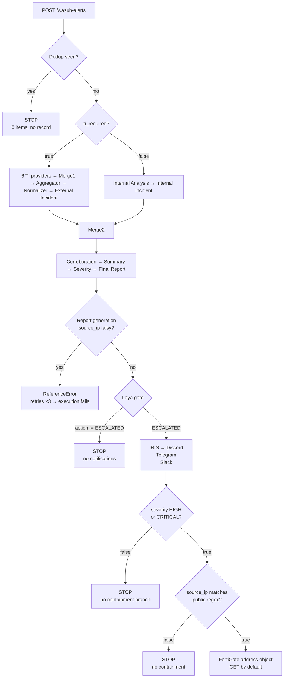

# 05 — Data Flow and Workflow Execution

| Item | Value |
|---|---|
| Document | Data flow, item shapes and execution paths |
| Version | 1.0 |
| Date | 2026-11-10 |
| Method | Static trace of the 31-node graph |

---

## 1. How an n8n item moves through the workflow

n8n passes **items** between nodes. Each item has a `json` object. Code nodes commonly
read `$input.first().json` (one item) or `$input.all()` (all items), and return either a
single item-like object or an array of `{ json }` objects.

This workflow almost always carries **one item per alert**. The exceptions are:

- After `TI required?` output 0, six items are produced (one per provider).
- `Merge1` appends those six items into a single list.
- `TI Aggregator` reads all six and emits **one** item.
- `Dedup Check` can emit **zero** items, ending that branch.
- `Laya Decision Gate` can emit **zero** items when the engine does not escalate.

```mermaid
flowchart LR
    A["1 item<br/>Wazuh alert"] --> B["1 item<br/>+ flat fields"]
    B --> C["1 item<br/>+ ioc arrays"]
    C --> D{"Dedup"}
    D -->|"seen"| Z["0 items<br/>branch ends"]
    D -->|"new"| E["1 item<br/>+ routing"]
    E --> F{"ti_required"}
    F -->|"true"| G["6 items<br/>provider responses"]
    G --> H["6 items appended<br/>Merge1"]
    H --> I["1 item<br/>aggregated TI"]
    F -->|"false"| J["1 item<br/>internal analysis"]
    I --> K["1 item<br/>{ incident } external"]
    J --> L["1 item<br/>{ incident } internal"]
    K --> M["Merge2"]
    L --> M
    M --> N["1 item<br/>{ incident }"]
    N --> O["1 item<br/>{ incident } scored"]
    O --> P["1 item<br/>{ report, iris_payload }"]
    P --> Q{"Laya gate"}
    Q -->|"not escalated"| Z2["0 items"]
    Q -->|"escalated"| R["4 parallel items<br/>IRIS, IF, Telegram, Slack"]
```



---

## 2. Example alert used throughout this document

All addresses below are synthetic documentation ranges from RFC 5737 and RFC 1918.
No real host, user or credential is represented. The full fixture is at
`workflows/samples/wazuh-alert.sample.json`.

```json
{
  "id": "1700000000.123456",
  "timestamp": "2026-11-10T10:15:00Z",
  "rule": {
    "id": "5710",
    "level": 10,
    "description": "sshd: Attempt to login using a non-existent user",
    "groups": ["authentication_failed", "sshd", "pam"],
    "mitre": { "id": ["T1110"], "tactic": ["Credential Access"], "technique": ["Brute Force"] }
  },
  "agent": { "id": "007", "name": "lab-edge-01", "ip": "10.20.30.40" },
  "data": {
    "srcip": "203.0.113.45",
    "srcuser": "admin",
    "command": "ssh admin@lab-edge-01"
  },
  "location": "/var/log/auth.log",
  "full_log": "Nov 10 10:15:00 lab-edge-01 sshd[2210]: Failed password for invalid user admin from 203.0.113.45 port 51422 ssh2"
}
```

The Wazuh integration posts this object. n8n wraps it:

```json
{
  "body": { "...": "the alert above" },
  "headers": { "content-type": "application/json" },
  "params": {},
  "query": {}
}
```

---

## 3. Stage-by-stage item shape

### Stage 0 — Webhook output

| Key | Example |
|---|---|
| `body` | full Wazuh alert |
| `headers` | HTTP headers |
| `params`, `query` | route/query parameters |

### Stage 1 — Edit Fields output

The original item plus:

```json
{
  "rule_level": 10,
  "agent_name": "lab-edge-01",
  "description": "sshd: Attempt to login using a non-existent user",
  "source_ip": "203.0.113.45",
  "rule_id": "5710",
  "agent_id": "007",
  "groups": ["authentication_failed", "sshd", "pam"]
}
```

Note that `groups` is typed as `string` in the node but the Wazuh value is an array.

### Stage 2 — IOC Extraction output

Adds:

```json
{
  "original_alert": { "...": "the Wazuh alert" },
  "ioc": {
    "type": "public_ip",
    "value": "203.0.113.45",
    "public_ips": ["203.0.113.45"],
    "private_ips": ["10.20.30.40"],
    "domains": [],
    "urls": [],
    "hashes": []
  },
  "ti_required": true,
  "internal_analysis_required": false
}
```

The private agent IP `10.20.30.40` is also extracted from the `agent.ip` field because
`scan()` walks the whole object, not just network fields.

### Stage 3 — Dedup Check output

Unchanged if new. If `seenAlerts["EXT|5710|lab-edge-01|203.0.113.45"]` exists and is
younger than three minutes, the node returns `[]` and the execution ends.

### Stage 4 — IOC Routing output

Overwrites several keys:

```json
{
  "ti_required": false,
  "laya_primary": {
    "stage": "Primary Determination",
    "verdict": "INTERNAL_METRIC_ANALYSIS",
    "reason": "Internal host event - TI bypassed to preserve API quota",
    "public_ip": "203.0.113.45",
    "hash": null,
    "timestamp": "2026-11-10T10:15:01.000Z"
  },
  "gatekeeper": {
    "decision": "BYPASS_TI",
    "reason": "Internal host event - TI bypassed to preserve API quota",
    "public_ip": "203.0.113.45",
    "hash": null
  },
  "source_ip": "203.0.113.45",
  "ioc": { "type": "none", "value": null }
}
```

**Important trace result for this example.** The Wazuh rule groups include `pam`, and
`data.srcuser` is present, so `isLocalHostEvent` is true. Even though a public IP exists,
`ti_required` becomes `false` and **no threat-intelligence provider is called**. This is a
concrete demonstration of the local-host suppression behaviour described in
[03 — Node reference](03-node-reference.md) and [07 — IOC and threat intelligence](07-ioc-and-threat-intelligence.md).

For a pure network alert (no `pam`/`sudo`/`syslog` group, no `srcuser`/`command`), the
same public IP would set `ti_required: true` and `ioc: { type: 'public_ip', value: '203.0.113.45' }`.

### Stage 5 — TI provider items (external path only)

Each provider emits one item with its own native response shape:

| Provider item | Recognised keys |
|---|---|
| Threat Fox | `query_status`, `data` |
| Grey Noise | `classification`, `noise`, `riot` |
| AbuseIPDB | `data.abuseConfidenceScore`, `data.totalReports`, `data.isp`, ... |
| OTX | `pulse_info.count` |
| VirusTotal | `data.attributes.last_analysis_stats` |
| LeakIX | `services`, `summary`, `host` |

On failure, the item may instead contain `error`, `message`, `statusCode` and similar n8n
error fields. `TI Aggregator` does not handle most of these.

### Stage 6 — TI Aggregator output

One item:

```json
{
  "original_alert": { "...": "..." },
  "rule_id": "5710",
  "raw_log": "Nov 10 10:15:00 ...",
  "rule_level": 10,
  "agent_name": "lab-edge-01",
  "description": "sshd: ...",
  "source_ip": "203.0.113.45",
  "ioc": { "type": "public_ip", "value": "203.0.113.45" },
  "threat_intelligence": {
    "greynoise":   { "status": "success", "classification": "malicious", "noise": false, "riot": false },
    "abuseipdb":   { "status": "success", "confidence": 92, "reports": 418, "tor": false, "country": "United States", "isp": "Example ISP", "domain": null },
    "otx":         { "status": "success", "pulses": 3 },
    "virustotal":  { "status": "success", "reputation": -12, "malicious": 14, "suspicious": 2, "harmless": 40, "undetected": 15 },
    "threatfox":   { "status": "no_result", "result": null },
    "leakix":      { "status": "not_checked", "services": [], "error": null }
  },
  "risk_score": 100,
  "provider_coverage": 83,
  "assessment_confidence": "HIGH",
  "evidence": [
    "GreyNoise classified the IP as malicious",
    "AbuseIPDB confidence score is 92/100",
    "VirusTotal reported 14 malicious detections",
    "AlienVault OTX has 3 associated pulses"
  ],
  "sources": ["GreyNoise", "AbuseIPDB", "VirusTotal", "AlienVault OTX", "ThreatFox"],
  "severity": "CRITICAL",
  "has_malicious_evidence": true,
  "malicious_sources": ["GreyNoise", "AbuseIPDB", "OTX", "VirusTotal"],
  "provider_failures": []
}
```

Risk calculation for this example: GreyNoise +30, AbuseIPDB ≥80 +30, VirusTotal ≥10 +25,
OTX >0 +15 = 100 (clamped). ThreatFox `no_result` adds 0 and is not a hit.

### Stage 7 — TI Normalizer output

Reshaped into `alert`, `threat_intelligence`, `assessment`, `sources`. The alert object
carries `severity: "CRITICAL"` and `risk_score: 100`.

### Stage 8 — External Incident / Internal Incident output

Both branches converge on:

```json
{
  "incident": {
    "original_alert": { "...": "..." },
    "rule_id": "5710",
    "raw_log": "...",
    "source_ip": "203.0.113.45",
    "agent_name": "lab-edge-01",
    "rule_level": 10,
    "description": "sshd: ...",
    "severity": "CRITICAL",
    "risk_score": 100,
    "ioc": { "type": "public_ip", "value": "203.0.113.45" },
    "analysis_type": "external",
    "internal_analysis": null,
    "threat_intelligence": { "...": "..." },
    "assessment": {
      "confidence": "HIGH",
      "provider_coverage": 83,
      "has_malicious_evidence": true,
      "malicious_sources": ["GreyNoise", "AbuseIPDB", "OTX", "VirusTotal"],
      "evidence": [ "...": "..." ],
      "provider_failures": []
    },
    "summary": null,
    "recommendation": null
  }
}
```

The internal variant has `analysis_type: "internal"`, `internal_analysis` populated,
`threat_intelligence: { status: "not_required" }`, and a rule-level-derived severity.

### Stage 9 — TI Corroboration & Scoring output

Sets `incident.assessment.verdict` and `incident.severity`:

- External, malicious evidence → `TRUE_POSITIVE_THREAT`, severity CRITICAL if risk ≥80.
- Adds `incident.laya_verification` with stage `"Secondary Verification"`.

### Stage 10 — Incident Summary, Severity, Final Report

`Incident Summary` rebuilds the incident defensively. `Severity` then **recomputes**
`severity` from rule level and TI evidence, overwriting the corroboration result.
`Final Report` emits:

```json
{
  "report": {
    "agent_name": "lab-edge-01",
    "scene_lines": [ "Sensor / Agent   : lab-edge-01  (10.20.30.40)", "..." ],
    "raw_alert": { "...": "..." },
    "wazuh_alert_id": "1700000000.123456",
    "rule_id": "5710",
    "rule_level": 10,
    "description": "sshd: ...",
    "source_ip": "203.0.113.45",
    "severity": "CRITICAL",
    "risk_score": 100,
    "analysis_type": "external",
    "threat_intelligence": { "...": "..." },
    "assessment": { "...": "..." },
    "summary": "High-confidence malicious activity detected from 203.0.113.45 ...",
    "recommendation": "Block external source IP at perimeter firewall, ..."
  },
  "severity": "CRITICAL",
  "iris_description": "[ENTERPRISE SOAR INCIDENT ASSESSMENT] ...",
  "iris_payload": {
    "alert_title": "[SOAR CRITICAL] sshd: ... on lab-edge-01",
    "alert_description": "[ENTERPRISE SOAR INCIDENT ASSESSMENT] ...",
    "alert_source": "Wazuh-SOAR",
    "alert_source_ref": "soar-5710-lab-edge-01-203.0.113.45",
    "alert_severity_id": 6,
    "alert_status_id": 1,
    "alert_customer_id": 1,
    "alert_tags": "wazuh,soar_enriched,rule_5710,external,critical"
  }
}
```

**Failure path for this stage.** If `source_ip` were missing, the `alert_source_ref`
expression would try to read `d.srcuser` and throw (C-03). No `iris_payload` would be
produced and no notification would be sent.

### Stage 11 — Laya Decision Gate output

Triage payload sent to the engine:

```json
{
  "timestamp": "2026-11-10T10:15:02.000Z",
  "host": "lab-edge-01",
  "vendor": "Wazuh",
  "rule_id": "5710",
  "rule_level": 10,
  "description": "sshd: ...",
  "source_ip": "203.0.113.45",
  "srcuser": "admin",
  "severity": "CRITICAL",
  "risk_score": 100,
  "threat_intelligence": { "...": "..." },
  "assessment": { "...": "..." },
  "groups": ["authentication_failed", "sshd", "pam"],
  "raw_alert": { "...": "full Wazuh alert" }
}
```

On escalation, the returned item is the input plus an enriched `iris_payload` and:

```json
{
  "laya_gate": {
    "human_intervention_required": true,
    "action": "ESCALATED",
    "correlation_id": "lay-...",
    "layer": 2,
    "verdict": "TRUE_POSITIVE_THREAT",
    "confidence": 0.94,
    "reason": "...",
    "stage": "L2 ...",
    "latency_ms": 764,
    "model_latency_ms": 712,
    "laya_model_used": true,
    "policy_version": "6.2",
    "evaluated_at": "2026-11-10T10:15:02.500Z"
  }
}
```

When the engine is unreachable, the code substitutes `ENGINE_UNAVAILABLE`, layer 4,
confidence 0.50 and `correlation_id: "lay-offline"`. The values above are **schema
examples**, not observed responses — no POST was sent to `/api/triage` during the audit.

### Stage 12 — Response items

All four nodes receive the same item:

| Node | Expression reads | Side effect |
|---|---|---|
| DFIR-IRIS Alert | `$json.iris_payload` | Create case, return `alert_id` |
| Discord Alert | `$json.laya_gate`, `$('Final Report')`, `$('DFIR-IRIS Alert')` | Embed with case link |
| Severity Confirmation | `$json.severity` | HIGH/CRITICAL → Is Public IP? |
| Send a text message | `$('Final Report')`, `$json.laya_gate`, `$('DFIR-IRIS Alert')` | Telegram HTML |
| Slack | `$('Final Report')`, `$json.laya_gate`, `$('DFIR-IRIS Alert')` | Slack message |

---

## 4. Execution paths



### Path A — external threat, escalated, CRITICAL, public IP

The intended "happy path": dedup passes → TI called → malicious evidence → CRITICAL →
Laya escalates → IRIS case → Discord embed → Telegram → Slack → Severity Confirmation
true → Is Public IP true → FortiGate address object. This path exercises all node groups.

### Path B — internal host event

`data.srcuser` present or a `pam`/`sudo`/`syslog` group → `ti_required: false` →
`Internal Analysis` → `Internal Incident` → Merge2 → Corroboration → Summary → Severity
→ Final Report. Threat intelligence is `not_required`.

Known divergence: an internal level-10 alert is severity HIGH in `Internal Incident` and
in `TI Corroboration & Scoring`, but the final `Severity` node recomputes to MEDIUM
(rule level 10 falls in the `>= 8` MEDIUM band). Because MEDIUM fails `Severity
Confirmation`, no FortiGate path is attempted.

### Path C — duplicate alert

`Dedup Check` returns `[]`. No IRIS case, no chat message, no metric. Suppression is
invisible except in n8n execution history.

### Path D — Laya engine unavailable

The Code node's HTTP call fails. The fail-safe escalates anything with rule level ≥ 8 or
HIGH/CRITICAL severity. IRIS and all three chat channels still receive the incident, but
the verdict is `ENGINE_UNAVAILABLE` with correlation ID `lay-offline`. Every alert at
level 8+ will escalate while the integration is broken.

### Path E — Laya auto-close

If the engine returned an `action` other than `ESCALATED`, `Laya Decision Gate` returns
`[]` and no response node executes. There is no explicit "closed" record in IRIS.

### Path F — MEDIUM/LOW escalated incident

IRIS, Discord, Telegram and Slack still run, but `Severity Confirmation` output 1 is
unconnected. No public-IP check, no FortiGate call, and no explicit "containment not
required" record.

### Path G — private or missing source IP

`Is Public IP?` output 1 is unconnected. The FortiGate branch ends. Note that
`Final Report` defaults a missing source IP to the string `N/A`, which the regex's
`.+` could still treat as "public".

---

## 5. Data-retention and volume observations

| Data | Where it can persist | Contains |
|---|---|---|
| Full Wazuh alert | n8n execution data, IRIS case, Discord/Telegram/Slack messages, Laya payload | usernames, commands, IPs, hostnames, raw log lines |
| `scene_lines` | IRIS description, chat messages | truncated raw event (1,400 chars) |
| Dedup fingerprints | n8n static workflow data | rule ID, agent name, IP, user, command |
| Provider responses | n8n execution data | reputation, ISP, country, pulse counts |
| Laya decision record | IRIS tags/description | correlation ID, verdict, confidence, reason |

No field is redacted before entering execution history or chat messages. In a production
SOC, Wazuh alerts must be treated as sensitive: they can contain PII, credentials in
command lines, and internal hostnames.

A single alert can trigger up to **six outbound TI calls plus four response calls**. A
1,000-alert burst is up to 10,000 external HTTP requests. There is no queue, throttle,
budget guard or circuit breaker in the workflow.

---

## 6. Race and concurrency considerations

| Risk | Detail |
|---|---|
| Dedup race | Two executions can both read an absent key before either writes it (no atomic check-and-set) |
| Multiple n8n instances | Static workflow data is not shared, so dedup windows are per instance/workflow |
| Provider response order | Merge1 Append preserves input order by index, not completion order |
| Notification fan-out | IRIS, Telegram, Slack and Severity Confirmation run in parallel; Telegram/Slack read IRIS output via `$('DFIR-IRIS Alert')` and may execute before it returns |
| Case ID | Discord/Telegram/Slack wrap the IRIS lookup in `try/catch` and fall back to `null` if IRIS has not completed |

The cross-node `$('DFIR-IRIS Alert')` lookups in the parallel notification branches are a
real ordering hazard: if the notification expression evaluates before the IRIS node
finishes, the case ID will be missing even though the case is created later.

---

## 7. Validation of this trace

This trace was produced by reading the exported node parameters and Code node source. It
was **not** produced by executing the workflow. Behaviour that depends on n8n runtime
semantics — Merge2 with one active branch, Code node `fetch`, the exact shape of provider
error items, and the response of `/api/triage` — is marked as unverified in
[15 — Limitations](15-limitations-and-roadmap.md).

---

## 8. Related documents

- [02 — Architecture](02-architecture.md)
- [03 — Node reference](03-node-reference.md)
- [06 — Wazuh integration](06-wazuh-integration.md)
- [07 — IOC and threat intelligence](07-ioc-and-threat-intelligence.md)
- [08 — Correlation and severity](08-correlation-and-severity.md)
- [12 — Testing and validation](12-testing-and-validation.md)
