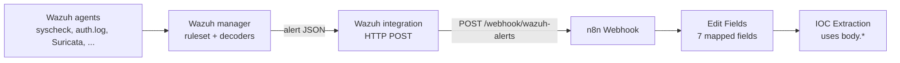

# 06 — Wazuh Integration and Alert Structure

| Item | Value |
|---|---|
| Document | Wazuh integration contract |
| Version | 1.0 |
| Date | 2026-11-10 |
| Basis | Static analysis of `Webhook`, `Edit Fields`, `IOC Extraction`, `Dedup Check`, `IOC Routing`, `Internal Analysis`, `Final Report` |

---

## 1. Role of Wazuh in the system

Wazuh is the **only event producer**. The n8n workflow does not poll Wazuh; it waits for
an HTTP POST. There is no feedback path from the workflow back to the Wazuh manager.



The workflow assumes the alert arrives as JSON with a `Content-Type: application/json`
header so that n8n parses it into `$json.body`. If Wazuh sends a raw string body or a
different content type, `IOC Extraction` has a JSON-string fallback, but `Edit Fields`
expressions would see no `body.rule.level`.

---

## 2. Wazuh alert structure used by the workflow

A Wazuh alert is a JSON object. The fields the workflow actually reads are:

| Path | Used by | Purpose |
|---|---|---|
| `rule.id` | Edit Fields, Aggregator, Final Report, Laya | Rule identifier |
| `rule.level` | Edit Fields, Severity, Corroboration, Summary, Laya | Wazuh severity 0–15 |
| `rule.description` | Edit Fields, Final Report, Laya | Human-readable description |
| `rule.groups` | Edit Fields, IOC Routing, Final Report | Group membership; used for local-host detection |
| `rule.mitre.id` / `.tactic` / `.technique` | Internal Analysis, Final Report | MITRE ATT&CK |
| `agent.id` | Edit Fields | Agent identifier |
| `agent.name` | Edit Fields, all report builders, Laya | Host name |
| `agent.ip` | Final Report scene | Agent address |
| `data.srcip` | Edit Fields, Dedup, Routing | Primary source IP |
| `data.src_ip`, `data.source_ip`, `srcip`, `source_ip` | IOC Routing | Alternative IP fields |
| `data.srcuser`, `data.user`, `data.dstuser`, `data.target_user` | Internal Analysis, Dedup, Laya | Account context |
| `data.command`, `data.audit.command` | Internal Analysis, Dedup, Final Report | Executed command |
| `data.md5`, `data.sha1`, `data.sha256`, `data.hash`, `data.file_hash` | IOC Routing, IOC Extraction | File hashes |
| `syscheck.md5_after`, `sha1_after`, `sha256_after`, `path` | IOC Routing, Final Report | FIM artifacts |
| `data.http.*` | Final Report scene | HTTP request details |
| `data.win.eventdata.*` | Final Report scene | Windows process details |
| `data.flow.*` | Final Report scene | Suricata flow counters |
| `data.alert.*` | Final Report scene | Suricata signature and metadata |
| `data.office365.*` | Final Report scene | Cloud audit events |
| `data.vulnerability.*` | Final Report scene | Vulnerability detector |
| `location` | IOC Routing, Final Report | Log source |
| `full_log` | Final Report, Laya | Raw event text |
| `id` | Final Report | Wazuh alert ID |
| `timestamp` | Not used by the workflow | Event time |

**Not read by the workflow:** `timestamp`, `manager`, `cluster`, `decoder`, `previous_output`,
`input`, `predecoder`, `GeoLocation` in a structured way. `timestamp` is replaced by
`new Date().toISOString()` in the Laya payload, so engine-side event time reflects
processing time, not detection time.

---

## 3. Field mapping in `Edit Fields`

| Target field | Primary expression | Fallback | Type declared |
|---|---|---|---|
| `rule_level` | `$json.body?.rule?.level` | `$json.rule?.level` → `null` | number |
| `agent_name` | `$json.body?.agent?.name` | `$json.agent?.name` → `null` | string |
| `description` | `$json.body?.rule?.description` | `$json.rule?.description` → `null` | string |
| `source_ip` | `$json.body?.data?.srcip` | `$json.data?.srcip` → `null` | string |
| `rule_id` | `$json.body?.rule?.id` | `$json.rule?.id` → `null` | string |
| `agent_id` | `$json.body?.agent?.id` | `$json.agent?.id` → `null` | string |
| `groups` | `$json.body?.rule?.groups` | `$json.rule?.groups` → `[]` | string |

`includeOtherFields: true` means the webhook item's `body`, `headers`, `params` and
`query` are retained. Downstream Code nodes therefore see both the flat mapped fields and
the nested alert. This redundancy is deliberate: it allows the same workflow to be fed by
a manual "Execute Workflow" item or by a direct alert, not just by the webhook.

### Mapping gaps

| Gap | Consequence | Mitigation |
|---|---|---|
| `source_ip` only reads `data.srcip` | Suricata IPs, Windows IPs and alternate field names are missed at this stage | `IOC Routing` compensates with seven candidate paths |
| `groups` typed as string | Array values may be coerced | Not critical; Code nodes read `alert.rule.groups` from the original alert |
| No `timestamp` | Reports use processing time | Add `event_time` mapping |
| No `rule.firetime`, `agent.ip` mapping | Scene builder re-reads the raw alert | Acceptable |
| No validation | `null`/strings propagate | Add a schema-validation Set/Code node after the webhook |

---

## 4. Webhook endpoint contract

| Property | Value |
|---|---|
| Method | `POST` |
| Path | `wazuh-alerts` |
| Production URL | `{N8N_BASE_URL}/webhook/wazuh-alerts` |
| Test URL | `{N8N_BASE_URL}/webhook-test/wazuh-alerts` |
| Authentication | None configured |
| IP allowlist | None configured |
| Rate limiting | None configured |
| Body size limit | Not set in the workflow |
| Expected content type | `application/json` |
| Response | Default n8n webhook response after workflow completion |

Because the response is produced after the entire pipeline finishes — six provider calls,
report generation, an engine call and four notifications — the request can take several
seconds. If the Wazuh integration has a short timeout or retries on non-2xx/timeout, the
same alert can be delivered more than once. `Dedup Check` partly mitigates this, but the
dedup window starts at ingestion and is not atomic.

### Example request (synthetic)

```http
POST /webhook/wazuh-alerts HTTP/1.1
Host: REPLACE_WITH_N8N_HOST
Content-Type: application/json
X-SOC-Signature: REPLACE_WITH_HMAC_IF_IMPLEMENTED

{
  "id": "1700000000.123456",
  "timestamp": "2026-11-10T10:15:00Z",
  "rule": { "id": "5710", "level": 10,
            "description": "sshd: Attempt to login using a non-existent user",
            "groups": ["authentication_failed", "sshd"] },
  "agent": { "id": "007", "name": "lab-edge-01", "ip": "10.20.30.40" },
  "data": { "srcip": "203.0.113.45", "srcuser": "admin" },
  "location": "/var/log/auth.log",
  "full_log": "Nov 10 10:15:00 lab-edge-01 sshd[2210]: Failed password ..."
}
```

The `X-SOC-Signature` header is shown as a **placeholder for a future control**. It is
not implemented in the exported workflow. See [09 — Hermes AI integration](09-hermes-ai-integration.md)
and [14 — Security](14-security.md).

---

## 5. Wazuh-side configuration

The exact integration block depends on the Wazuh version and whether a custom integration
script is used. The following is an **illustrative example** to be verified against your
Wazuh documentation; it is not a tested configuration.

```xml
<ossec_config>
  <integration>
    <name>custom-webhook</name>
    <hook_url>https://REPLACE_WITH_N8N_HOST/webhook/wazuh-alerts</hook_url>
    <level>7</level>
    <alert_format>json</alert_format>
  </integration>
</ossec_config>
```

Recommended additions, subject to Wazuh version support:

- Filter by `rule_id` or `group` to avoid forwarding all level-7+ events.
- Use a dedicated integration script that adds an HMAC signature header and a timestamp.
- Set a timeout and a bounded retry policy.
- Send `Content-Type: application/json`.
- Log delivery failures locally without including alert bodies.

### Wazuh rule levels in this workflow

| Level | Meaning in the workflow |
|---|---|
| `< 7` | `BENIGN_TELEMETRY` in Corroboration (unless malicious evidence exists) |
| `8–9` | MEDIUM base severity in `Severity` |
| `10–11` | MEDIUM in `Severity`, HIGH in Corroboration for internal alerts |
| `12–14` | HIGH in `Severity`, CRITICAL in Corroboration for internal alerts |
| `≥ 15` | CRITICAL base severity |

The disagreement between these bands is documented in
[08 — Correlation and severity](08-correlation-and-severity.md).

---

## 6. Alert-shape handling across the Code nodes

Four nodes independently resolve "the alert":

| Node | Resolution order |
|---|---|
| IOC Extraction | `input.body` (object) → `JSON.parse(input.body)` if string → `input` |
| Dedup Check | `data.body` (object) → `data.original_alert` → `data` |
| IOC Routing | `data.body` (object) → `data.original_alert` → `data` |
| Internal Analysis | `data.body` (object) → `data.original_alert` → `data` |
| Final Report | `incident.original_alert` (already stored) |

This works for the standard webhook shape but creates subtle differences:

- `IOC Extraction` stores `original_alert: alert`, which is `body` for webhook inputs.
- `Dedup Check` and `IOC Routing` prefer `body` again, so they read the same object.
- `Internal Analysis` builds a **new** `alert` object with `original_alert` inside it, which
  changes the nesting for internal incidents.
- `Final Report` reads `incident.original_alert`, which for internal incidents came from
  `Internal Incident`'s `alert.original_alert ?? data.original_alert ?? alert`.

A single normalisation function would remove this ambiguity.

---

## 7. Dedup fingerprint input

`Dedup Check` reads from the **raw** alert, not the mapped fields:

| Fingerprint part | Source |
|---|---|
| `ruleId` | `alert.rule.id` → `data.rule_id` → `'norule'` |
| `agentName` | `alert.agent.name` → `data.agent_name` → `'blusoc'` |
| `sourceIp` | `alert.data.srcip` → `alert.srcip` → `data.source_ip` → `''` |
| `command` | `alert.data.command` |
| `user` | `alert.data.srcuser` → `alert.data.user` |

High-volume rules (`235x`, `19xxx`, `915xx`, `86611`–`86613`) use only rule and agent.
Other public IPs use `EXT|rule|agent|ip`; user/command events use
`INT|rule|agent|user|command`; everything else uses `GEN|rule|agent|description`.

Because the fingerprint includes the full command string, two alerts that differ only in
whitespace or a timestamp inside the command are not suppressed. Conversely, the
high-volume pattern collapses all alerts from one rule on one agent into a single event
per three minutes, which may hide distinct vulnerabilities.

---

## 8. Integration hardening checklist

| # | Control | Current state | Priority |
|---|---|---|---|
| 1 | Webhook authentication (Header Auth / JWT / mTLS) | Absent | Critical |
| 2 | Source IP allowlist at reverse proxy | Absent | Critical |
| 3 | Rate limiting and burst control | Absent | High |
| 4 | Maximum request body size | Absent | High |
| 5 | JSON schema validation of the alert | Absent | High |
| 6 | HMAC signature + timestamp verification | Absent | High |
| 7 | Explicit fast `202 Accepted` response | Absent | Medium |
| 8 | Delivery retry/dead-letter on the Wazuh side | Unknown | Medium |
| 9 | Alert payload redaction before execution history | Absent | Medium |
| 10 | Structured ingestion metrics | Absent | Low |

A minimal schema check after the webhook should require `body.rule.id`,
`body.rule.level` (number 0–15), `body.agent.name`, and reject payloads above a size
limit. This prevents malformed or hostile payloads from reaching six paid APIs.

---

## 9. Sample files

| File | Purpose |
|---|---|
| `workflows/samples/wazuh-alert.sample.json` | Synthetic Wazuh alert with RFC 5737 addresses |
| `workflows/samples/n8n-webhook-item.sample.json` | The same alert wrapped in n8n's `body` object |

Both are safe to commit: no real IPs, users, hosts, keys or webhook URLs.

---

## 10. Related documents

- [03 — Node reference](03-node-reference.md) for Webhook and Edit Fields parameters.
- [05 — Data flow](05-data-flow.md) for the full item trace.
- [07 — IOC and threat intelligence](07-ioc-and-threat-intelligence.md) for extraction.
- [11 — Installation](11-installation.md) for setup steps.
- [13 — Troubleshooting](13-troubleshooting.md) for ingestion failures.
- [14 — Security](14-security.md) for the threat model.
