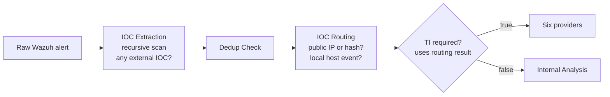
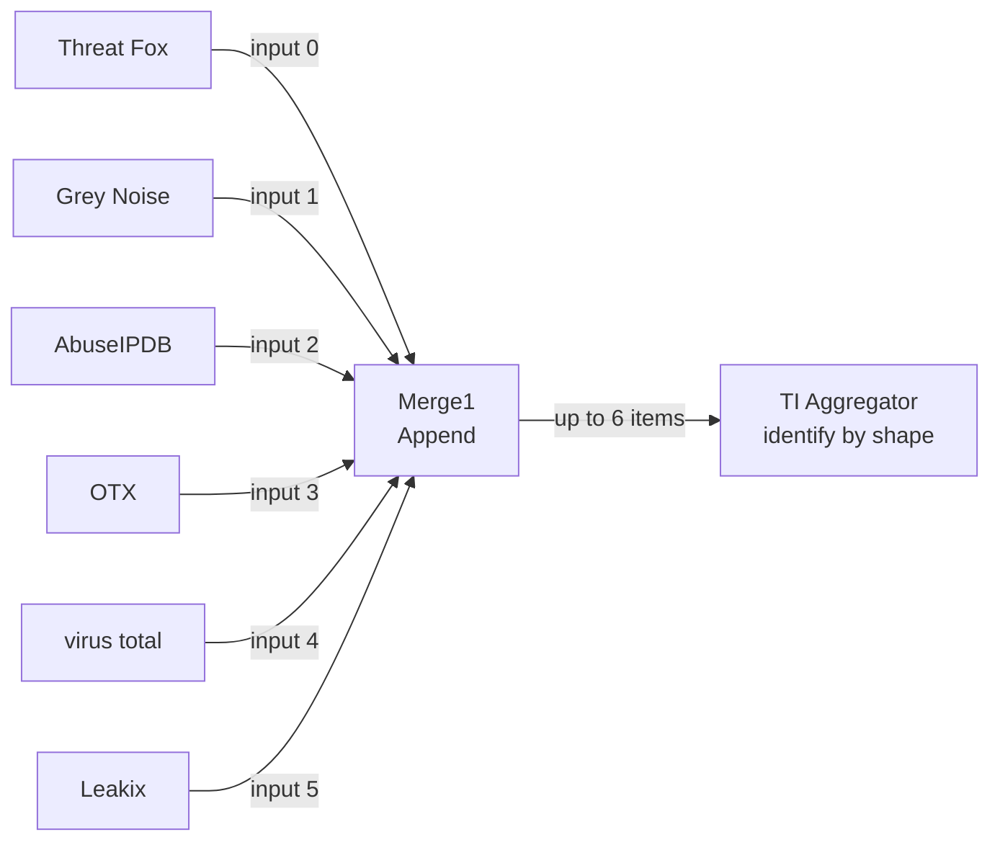
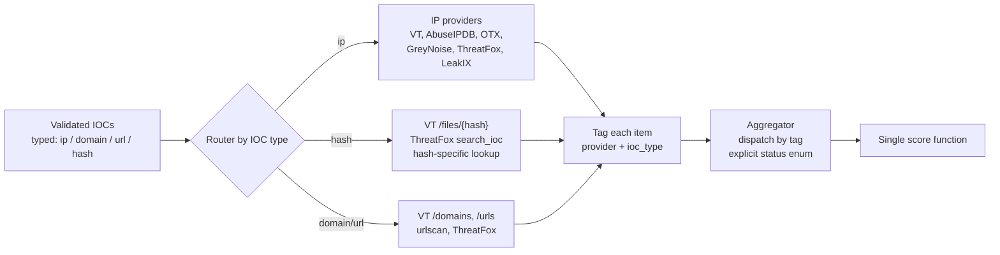

# 07 — IOC Extraction and Threat-Intelligence Enrichment

| Item | Value |
|---|---|
| Document | IOC extraction, TI providers, aggregation and normalisation |
| Version | 1.0 |
| Date | 2026-11-10 |
| Nodes covered | IOC Extraction, IOC Routing, TI required?, six HTTP Request nodes, Merge1, TI Aggregator, TI Normalizer, External Incident |

---

## 1. Two-stage detection and routing

The workflow determines TI eligibility **twice** with different rules.



| Stage | Sets `ti_required` based on | Notes |
|---|---|---|
| IOC Extraction | any public IP, URL, domain or hash found anywhere in the alert | Broad; includes the agent's private IP in `private_ips` but does not trigger TI for it |
| IOC Routing | a verified public IP **not** in a local host event, or a valid hash | Narrower; overwrites the extraction result |

The `TI required?` IF node reads the **routing** result. `IOC Extraction`'s
`ti_required` is effectively dead data.

---

## 2. IOC Extraction algorithm

### 2.1 Input resolution

```text
input.body is an object      → alert = input.body
input.body is a string       → alert = JSON.parse(input.body), else input
otherwise                    → alert = input
if alert is not an object    → return empty IOC set, ti_required = false
```

### 2.2 Collectors

| Set | Contents |
|---|---|
| `publicIPs` | IPv4 addresses not in the private ranges |
| `privateIPs` | IPv4 addresses in the private ranges |
| `domains` | Domain strings passing `isPlausibleDomain` |
| `urls` | `http://` and `https://` strings |
| `hashes` | 32, 40 or 64 character hex strings |

`scan(value, depth)` recurses over strings, arrays and object entries with a depth cap of
10. For objects it additionally inspects key names to find known hash, IP, URL and domain
fields before scanning child values. `scanText` applies four regexes to each string.

### 2.3 Regexes

| Type | Pattern | Notes |
|---|---|---|
| URL | `/\bhttps?:\/\/[^\s"'<>]+/gi` | trailing `),.;` stripped |
| IPv4 | `/\b(?:\d{1,3}\.){3}\d{1,3}\b/g` | octets validated 0–255 afterwards |
| Hash | `/\b[a-fA-F0-9]{32}\b|\b[a-fA-F0-9]{40}\b|\b[a-fA-F0-9]{64}\b/g` | MD5, SHA-1, SHA-256 |
| Domain | `/\b(?:[a-zA-Z0-9](?:[a-zA-Z0-9-]{0,61}[a-zA-Z0-9])?\.)+[a-zA-Z]{2,63}\b/g` | then filtered by TLD allowlist |

### 2.4 Private IPv4 classification

`isPrivateIPv4` rejects only:

- `10.0.0.0/8`
- `172.16.0.0/12`
- `192.168.0.0/16`
- `127.0.0.0/8`
- `169.254.0.0/16`
- `0.0.0.0/8`

It does **not** reject `100.64.0.0/10` (CGNAT), `192.0.2.0/24`, `198.51.100.0/24`,
`203.0.113.0/24` (documentation), `198.18.0.0/15` (benchmarking), `224.0.0.0/4`
(multicast) or `240.0.0.0/4` (reserved). `IOC Routing` rejects CGNAT and `>= 224`, so the
two stages disagree on those ranges.

IPv6 is not detected at all. `::1` appears only in `IOC Routing`'s literal list.

### 2.5 TLD allowlist

```text
com  net  org  io  co  in  uk  de  fr  us  ca  au
info biz  xyz  online site app dev cloud me tv tech pro gov edu
```

26 suffixes. Consequences:

- Domains under `.ru`, `.cn`, `.jp`, `.br`, `.tk`, `.top`, `.cc`, `.su`, `.xyz` (present),
  `.shop`, `.live`, `.click`, `.zip`, `.mov` and most ccTLDs/new gTLDs are discarded.
- The separate 30-entry file-extension denylist (`html`, `exe`, `dll`, `js`, `json`,
  `pdf`, `zip`, `ps1`, `py`, `java`, …) is almost redundant because none of those appear
  in `VALID_TLDS`.
- A URL whose host uses an unsupported TLD still appears in `urls`, but its domain is not
  extracted. Since URL presence triggers TI, this is partially mitigated.

### 2.6 Primary IOC priority

| Priority | Type | Source |
|---:|---|---|
| 1 | `public_ip` | first `publicIPs` entry |
| 2 | `url` | first `urls` entry |
| 3 | `domain` | first `domains` entry |
| 4 | `hash` | first `hashes` entry |
| 5 | `private_ip` | first `privateIPs` entry |
| — | `none` | no IOC found |

**Risk.** `publicIPs[0]` is insertion-order dependent and does not distinguish source from
destination. For a Suricata alert with both `src_ip` and `dest_ip`, the destination of an
outbound connection may be selected as the "attacker" IP and enriched as such.

### 2.7 Output

```json
{
  "original_alert": { "...": "..." },
  "ioc": {
    "type": "public_ip",
    "value": "203.0.113.45",
    "public_ips": ["203.0.113.45"],
    "private_ips": ["10.20.30.40"],
    "domains": [],
    "urls": [],
    "hashes": []
  },
  "ti_required": true,
  "internal_analysis_required": false
}
```

`IOC Routing` later replaces `ioc` with a two-field object `{ type, value }`, discarding
the arrays. `AbuseIPDB` still tries `$json.ioc?.public_ips?.[0]`, which no longer exists
at that point.

---

## 3. IOC Routing (primary judgement)

### 3.1 Candidate IP order

1. `alert.data.srcip`
2. `alert.data.src_ip`
3. `alert.data.source_ip`
4. `alert.srcip`
5. `alert.source_ip`
6. `data.source_ip` (mapped field)
7. `data.ioc.value`

The first value passing `isPrivateOrLocalIP` becomes `verifiedPublicIP`.

### 3.2 Private/local predicate

Rejects `localhost`, `127.0.0.1`, `::1`, `0.0.0.0`, non-4-part strings, non-numeric
octets, `10/8`, `172.16/12`, `192.168/16`, `127/8`, `169.254/16`, `100.64/10`, `0/8`
and `>= 224`.

### 3.3 Hash candidates

`data.md5`, `data.sha1`, `data.sha256`, `data.hash`, `data.file_hash`,
`syscheck.md5_after`, `syscheck.sha1_after`, `syscheck.sha256_after`, and top-level
`md5`/`sha1`/`sha256`. Validated as 32/40/64 lowercase hex.

### 3.4 Local host event detection

```text
rule.groups includes "sudo" OR "pam" OR "syslog"
OR location === "journald"
OR data.srcuser !== undefined
OR data.command !== undefined
```

A Wazuh authentication alert that includes a username (very common) is classified as a
local host event, so TI is bypassed even when a public source IP is present. The comment
says this is "to preserve API quota"; the side effect is that a large class of
internet-facing brute-force alerts is never enriched.

### 3.5 Decision table

| Public IP | Local event | Hash | `ti_required` | `ioc` | `source_ip` |
|---|---|---|---|---|---|
| yes | no | any | `true` | `public_ip` | public IP |
| yes | yes | none | `false` | `none` | public IP |
| any | any | yes | `true` | `hash` | public IP or first candidate |
| no | no | no | `false` | `none` | first candidate or `null` |

### 3.6 Hash enrichment defect

When a hash triggers TI, all six provider nodes still receive an IP-oriented request:

| Provider | Request | Problem |
|---|---|---|
| VirusTotal | `/api/v3/ip_addresses/{{$json.ioc.value}}` | IP endpoint with a hash value |
| AbuseIPDB | `ipAddress = $json.ioc?.public_ips?.[0] ?? $json.source_ip ?? null` | `public_ips` removed; falls back to IP or null |
| OTX | `/indicators/IPv4/{{$json.source_ip}}/general` | IPv4 endpoint |
| GreyNoise | `/v3/community/{{$json.source_ip}}` | IP endpoint |
| ThreatFox | `search_term = {{$json.source_ip}}` | Searches the IP, not the hash |
| LeakIX | `/host/{{$json.source_ip}}` | Host endpoint |

There is no hash-specific VirusTotal `/files/{hash}` path, no ThreatFox hash search, and
no domain/URL provider path. **Hash, URL and domain IOCs are not enriched correctly.** See
H-06.

---

## 4. Threat-intelligence providers

### 4.1 Request matrix

| Provider | Method | Endpoint | Auth | Input expression | Response detector |
|---|---|---|---|---|---|
| Threat Fox | `POST` | `https://threatfox-api.abuse.ch/api/v1/` | `auth-key` header | `{"query":"search_ioc","search_term":"{{$json.source_ip}}"}` | `query_status` |
| Grey Noise | GET (default) | `https://api.greynoise.io/v3/community/{{$json.source_ip}}` | `key` header | URL path | `classification`/`noise`/`riot` |
| AbuseIPDB | GET (default) | `https://api.abuseipdb.com/api/v2/check` | `key` header | `ipAddress`, `maxAgeInDays=90` | `data.abuseConfidenceScore` |
| OTX | GET (default) | `https://otx.alienvault.com/api/v1/indicators/IPv4/{{$json.source_ip}}/general` | `X-OTX-API-KEY` | URL path | `pulse_info.count` |
| virus total | GET (default) | `https://www.virustotal.com/api/v3/ip_addresses/{{$json.ioc.value}}` | `x-apikey` | URL path | `data.attributes.last_analysis_stats` |
| Leakix | GET (default) | `https://leakix.net/host/{{$json.source_ip}}` | `api-Key` header | URL path | `services`/`summary`/`host` |

All six have `onError: continueRegularOutput`. `virus total` and `OTX` also set
`alwaysOutputData: true`. `Leakix` sets `retryOnFail: true` with no `maxTries`.
`Grey Noise` sets `neverError: true`, which converts non-2xx responses to data.

### 4.2 Credentials

The raw export hard-coded all six keys plus the FortiGate and IRIS bearer tokens. The
sanitized export uses `REPLACE_WITH_*` placeholders. Preferred target state:

| Provider | Recommended n8n credential |
|---|---|
| Threat Fox, Grey Noise, AbuseIPDB, OTX, VirusTotal, LeakIX | Header Auth credential, or environment variable bound in the HTTP node |
| FortiGate, DFIR-IRIS | Header Auth credential with a bearer token |
| Telegram, Slack | Native n8n credentials (already used) |

Never inline a key in a node parameter in a shared instance.

### 4.3 Quota and cost considerations

Provider quotas vary by plan and change over time; verify current limits before rollout.
The workflow has **no per-provider budget guard**. For each alert that passes routing, all
six providers are called, regardless of rule level, IOC type or recent calls. With a
3-minute dedup window and high-volume rule families, a scan burst can still exhaust a
free-tier quota quickly.

Recommended controls:

- Cache provider results by IOC for a configurable TTL.
- Skip providers whose key is not configured.
- Add a per-hour budget counter in static workflow data or an external cache.
- Use the dedup high-volume fingerprints correctly (see H-04).
- Log provider status codes without logging response bodies.

---

## 5. Merge1 and shape-based identification

`Merge1` has `numberInputs: 6` and no mode parameter, so n8n uses default **Append**.
The official Merge documentation states Append "waits for the execution of all connected
inputs" and outputs items one after another.



`TI Aggregator` loops over `$input.all()` and uses `if` chains on response fields. There
is no provider name in the item. Risks:

- Provider response shape changes silently break detection.
- An error item containing a coincidentally matching field can be misclassified.
- Two providers with overlapping shapes would overwrite each other.
- Provider order is fixed by input index, not by actual completion order.

**Recommended fix.** Insert a Set node after each provider that adds
`provider: "virustotal"` (and so on), then dispatch on `item.json.provider` in the
aggregator. This also makes `provider_failures` meaningful.

---

## 6. TI Aggregator

### 6.1 Base result

```json
{
  "original_alert": {}, "rule_id": "N/A", "raw_log": null,
  "rule_level": null, "agent_name": null, "description": null,
  "source_ip": null,
  "ioc": { "type": null, "value": null },
  "threat_intelligence": {
    "greynoise":    { "status": "not_checked", "classification": null, "noise": null, "riot": null },
    "abuseipdb":    { "status": "not_checked", "confidence": null, "reports": null, "tor": null, "country": null, "isp": null, "domain": null },
    "otx":          { "status": "not_checked", "pulses": null },
    "virustotal":   { "status": "not_checked", "reputation": null, "malicious": null, "suspicious": null, "harmless": null, "undetected": null },
    "threatfox":    { "status": "not_checked", "result": null },
    "leakix":       { "status": "not_checked", "services": [], "error": null }
  },
  "risk_score": 0, "provider_coverage": 0,
  "assessment_confidence": "LOW", "evidence": [], "sources": []
}
```

The original alert is fetched again with `$('IOC Extraction').first().json` inside
`try/catch`, so provider-only error items do not lose alert context.

### 6.2 Risk weights

| Condition | Points |
|---|---:|
| GreyNoise `classification === "malicious"` | +30 |
| AbuseIPDB `abuseConfidenceScore >= 80` | +30 |
| AbuseIPDB `>= 50` | +15 |
| AbuseIPDB `> 0` | +5 |
| VirusTotal `malicious >= 10` | +25 |
| VirusTotal `malicious > 0` | +15 |
| OTX `pulses > 0` | +15 |
| ThreatFox `status === "success"` | +0 |
| LeakIX services found | +0 |

Score is clamped to `[0, 100]`.

### 6.3 Derived fields

| Field | Derivation |
|---|---|
| `assessment_confidence` | HIGH ≥3 malicious signals, MEDIUM 2, LOW 1 or 0 |
| `severity` | ≥80 CRITICAL, ≥50 HIGH, ≥25 MEDIUM, else LOW |
| `has_malicious_evidence` | `maliciousSignals.length > 0` |
| `malicious_sources` | array of provider names |
| `provider_coverage` | round(`checked / 6 * 100`) where checked includes `success`, `no_result` **and `unavailable`** |
| `provider_failures` | array of **indices** of providers with `status: "unavailable"` |

### 6.4 Known defects

| ID | Defect |
|---|---|
| H-05 | Any ThreatFox `query_status !== "no_result"` becomes `success`; error statuses then force CRITICAL in `Severity` |
| M-03 | `provider_coverage` counts unavailable providers as covered; `provider_failures` returns indices, not names |
| M-04 | LeakIX success requires a flat object with `services`/`summary`/`host`; alternate shapes stay `not_checked` |
| M-09 | n8n error items are not mapped to `unavailable` except for `data.error` with `ETIMEDOUT`/`leakix` text |
| L-04 | `successfulProviders` is computed but unused; 249-line ISO map embedded in logic |

---

## 7. TI Normalizer

Converts the flat aggregator result into three objects. Key renames:

| Aggregator | Normalizer |
|---|---|
| `abuseipdb.confidence` | `abuseipdb.confidence_score` |
| `abuseipdb.reports` | `abuseipdb.total_reports` |
| `assessment_confidence` | `assessment.confidence` |
| `severity`, `risk_score` | `alert.severity`, `alert.risk_score` and `assessment.*` |

All fields use `?? "not_checked"` or `?? null` defaults. `sources` is passed through but
not used downstream. This node is a low-risk reshape.

---

## 8. External Incident

Wraps the normalized result into `{ incident: {...} }` with
`analysis_type: "external"`, `internal_analysis: null`, `summary: null`,
`recommendation: null`, and an `assessment` object with confidence, coverage, malicious
evidence, evidence list and provider failures. It intentionally does not copy a verdict;
the verdict is assigned later by `TI Corroboration & Scoring`.

---

## 9. Failure-mode matrix

| Failure | Node behaviour | Aggregator sees | Downstream effect |
|---|---|---|---|
| 401/403 invalid key | `continueRegularOutput` | n8n error item | Provider stays `not_checked`; coverage understated |
| 429 rate limited | same | error item | No backoff, no circuit breaker |
| 5xx provider outage | same | error item | No `unavailable` status except LeakIX timeout text |
| DNS/network failure | same | error item + `ETIMEDOUT` | Only LeakIX mapped to `unavailable` |
| Non-JSON response | `neverError: true` (GreyNoise) / text response | Unexpected shape | Detector may not fire |
| Empty success response | `alwaysOutputData` (VT, OTX) | Empty item | Ignored by aggregator |
| ThreatFox auth error | 200 with `query_status` error | `status: "success"` | **Severity forced CRITICAL** |
| Merge1 with fewer than 6 items | Append of available items | Fewer items | Coverage lower, no warning |

There is no retry policy per provider other than LeakIX's unbounded `retryOnFail`. There
is no structured provider health metric.

---

## 10. Recommended enrichment design



Additional recommendations:

1. Validate and URL-encode every IOC before inserting it into a URL.
2. Use explicit status enum: `ok | no_result | unavailable | error | not_configured`.
3. Map provider errors to `unavailable` and record the provider name and HTTP status.
4. Make ThreatFox success require `query_status === "ok"` and a non-empty `data`.
5. Add a cache keyed by IOC + provider with a TTL.
6. Add a per-run budget guard so a burst cannot exhaust quota.
7. Write unit fixtures for one good and one error response per provider.

---

## 11. Related documents

- [03 — Node reference](03-node-reference.md)
- [04 — Code audit](04-code-audit.md)
- [05 — Data flow](05-data-flow.md)
- [08 — Correlation and severity](08-correlation-and-severity.md)
- [12 — Testing and validation](12-testing-and-validation.md)
- [16 — Audit report](16-audit-report.md)
