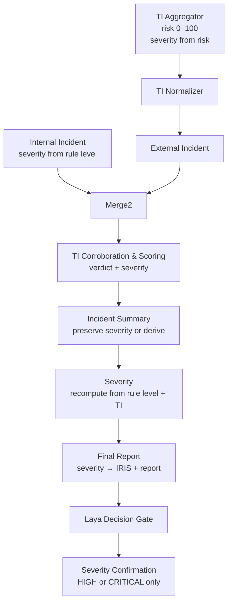
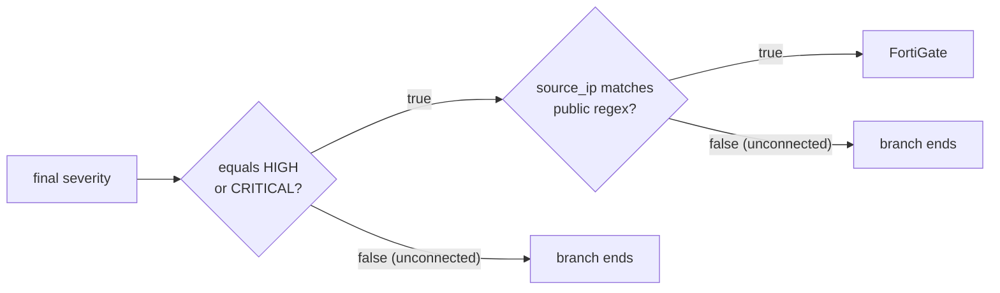

# 08 — Correlation, Scoring and Severity

| Item | Value |
|---|---|
| Document | Correlation, verdict assignment, risk scoring and severity derivation |
| Version | 1.0 |
| Date | 2026-11-10 |
| Nodes covered | TI Aggregator, TI Normalizer, Internal Incident, TI Corroboration & Scoring, Incident Summary, Severity, Final Report, Severity Confirmation |

---

## 1. The central problem: four sources of truth

The workflow computes risk or severity in **four** places, with different inputs and
different thresholds. The final value written by `Severity` is the one used for the report,
the Laya payload and `Severity Confirmation`.



| # | Node | Inputs | Output | Thresholds |
|---|---|---|---|---|
| 1 | TI Aggregator | Six provider results | `risk_score`, `severity` | ≥80 CRITICAL, ≥50 HIGH, ≥25 MEDIUM |
| 2 | Internal Incident | Wazuh rule level | `severity`, `risk_score` | ≥15 CRITICAL, ≥12 HIGH, ≥8 MEDIUM; risk 90/70/40/10 |
| 3 | TI Corroboration & Scoring | incident + assessment | `verdict`, `severity` | verdict-specific bands |
| 4 | Severity | rule level, risk, six provider objects | final `severity`, `severity_factors` | ≥15 CRITICAL, ≥12 HIGH, ≥8 MEDIUM + escalation rules |

`Incident Summary` is a fifth step but normally **preserves** the incoming severity; it
only derives one when missing.

---

## 2. Risk score (TI Aggregator)

```text
risk = 0
if GreyNoise.classification == "malicious"      risk += 30
if AbuseIPDB.confidence >= 80                  risk += 30
elif >= 50                                     risk += 15
elif > 0                                       risk += 5
if VirusTotal.malicious >= 10                  risk += 25
elif > 0                                      risk += 15
if OTX.pulses > 0                             risk += 15
if ThreatFox status == "success"               risk += 0   (no weight)
if LeakIX services found                       risk += 0   (no weight)
risk = clamp(risk, 0, 100)
```

**Observations.**

- ThreatFox and LeakIX are queried but do not contribute to the risk score.
- ThreatFox does influence severity indirectly and dangerously (see §6).
- GreyNoise `noise: true` and `riot` are parsed but never scored.
- `provider_coverage` reflects how many providers answered, not how many agreed.
- Confidence is HIGH/MEDIUM/LOW for ≥3 / 2 / ≤1 malicious signals, where a "malicious
  signal" is GreyNoise malicious, AbuseIPDB ≥80, OTX >0 or VirusTotal >0. ThreatFox is
  **not** counted here, even though `Severity` treats it as a hit.

---

## 3. Verdict assignment (TI Corroboration & Scoring)

| Order | Condition | Verdict | Severity | Confidence |
|---|---|---|---|---|
| 1 | `ruleLevel < 7` and no malicious evidence | `BENIGN_TELEMETRY` | LOW | HIGH |
| 2 | `analysis_type === "internal"` | `INTERNAL_SECURITY_EVENT` if level ≥10, else `BENIGN_INTERNAL_EVENT` | ≥12 CRITICAL, ≥10 HIGH, ≥8 MEDIUM, else LOW | HIGH / MEDIUM |
| 3 | external and (`hasMaliciousEvidence` or `risk >= 50`) | `TRUE_POSITIVE_THREAT` | CRITICAL if risk ≥80 or level ≥12, else HIGH | HIGH if ≥2 malicious sources, else MEDIUM |
| 4 | otherwise | `UNCORROBORATED_OR_TRAINING` | ≥12 HIGH, ≥8 MEDIUM, else LOW | LOW |

Every branch writes `incident.laya_verification` with stage `"Secondary Verification"`,
verdict, confidence, rule level, risk score and an ISO timestamp. Despite the name, this
node does **not** call the Laya engine.

The node's header comment describes it as "LAYA - METRIC & THREAT VERIFICATION (SECONDARY
DETERMINATION)" and "Multi-metric cross-correlation", but the implementation is a small
deterministic rule set. No model is invoked.

---

## 4. Final severity (Severity node)

### 4.1 Base

```text
severity = LOW
if ruleLevel >= 15 → CRITICAL
elif >= 12         → HIGH
elif >= 8          → MEDIUM
```

### 4.2 Escalations, in order

| # | Condition | Result |
|---:|---|---|
| 1 | `risk >= 80` and `corroboratingSources >= 3` | CRITICAL |
| 2 | `threatFoxHit` (`tf.status === "success"`) | CRITICAL |
| 3 | `vtMalicious >= 10` and `corroboratingSources >= 2` | CRITICAL |
| 4 | severity is not CRITICAL and `risk >= 50` and `corroboratingSources >= 2` | HIGH |
| 5 | severity is LOW and (`abuse >= 80` or `vt >= 1` or grey malicious or `otx > 0`) | HIGH |

`corroboratingSources` counts GreyNoise malicious, AbuseIPDB ≥80, VirusTotal >0, OTX >0
and ThreatFox `status === "success"`.

### 4.3 Trusted ISP downgrade

```text
trustedISP = ["Google LLC", "Cloudflare", "Microsoft", "Amazon", "Akamai"]
trusted    = isp.toLowerCase().includes(any of the above)
noMaliciousEvidence = corroboratingSources === 0 && abuseScore === 0
                   && vtMalicious === 0 && !greyMalicious && !threatFoxHit && otxPulses === 0

if trusted && noMaliciousEvidence:
    severity = HIGH   if ruleLevel >= 15
               MEDIUM if ruleLevel >= 8
               LOW    otherwise
```

The comment says trusted ISP alone must never override malicious evidence, and the
`noMaliciousEvidence` guard enforces that. However, a rule-level-15 alert with no TI
evidence is downgraded from CRITICAL to HIGH — a Wazuh maximum-severity rule losing its
top severity because the IP belongs to a large cloud provider.

### 4.4 `severity_factors`

The node returns the full factor set: rule level, risk score, AbuseIPDB score,
VirusTotal malicious/suspicious, GreyNoise classification/noise, ThreatFox hit, OTX
pulses, corroborating sources, malicious source names, trusted ISP flag and
`leakix_unavailable`. This is the best auditability artefact in the pipeline, but it is
not written to IRIS or to any chat message.

---

## 5. IRIS severity mapping

`Final Report` maps the final severity to DFIR-IRIS IDs:

| Severity | `alert_severity_id` |
|---|---:|
| CRITICAL | 6 |
| HIGH | 5 |
| MEDIUM | 1 |
| LOW | 4 |

This is **non-monotonic**: LOW (4) ranks above MEDIUM (1) in numeric terms. Unless the
target IRIS instance assigns those exact semantics, LOW incidents may be prioritised
above MEDIUM ones. The mapping is hard-coded and undocumented in the workflow. Verify it
against the IRIS severity table before activation.

`alert_status_id: 1` and `alert_customer_id: 1` are also hard-coded.
`alert_source_ref` is `soar-{ruleId}-{agent}-{sourceIp}` with no timestamp, so repeated
alerts for the same tuple can collide.

---

## 6. Worked scenarios

All values are derived from the exported formulas. They are **static calculations**, not
runtime test results.

### Scenario A — internal level 10, no TI

| Stage | Value |
|---|---|
| Internal Incident | MEDIUM (level ≥8), risk 40 |
| TI Corroboration & Scoring | `INTERNAL_SECURITY_EVENT`, **HIGH** (level ≥10) |
| Incident Summary | preserves HIGH |
| Severity | **MEDIUM** (base level ≥8; no TI signals) |
| Final | MEDIUM |

A HIGH internal security event is reported as MEDIUM. `Severity Confirmation` is false, so
the FortiGate branch is skipped.

### Scenario B — internal level 13, no TI

| Stage | Value |
|---|---|
| Internal Incident | HIGH (level ≥12), risk 70 |
| Corroboration | `INTERNAL_SECURITY_EVENT`, **CRITICAL** (level ≥12) |
| Incident Summary | preserves CRITICAL |
| Severity | **HIGH** (base level ≥12) |
| Final | HIGH |

A CRITICAL internal event is reported as HIGH.

### Scenario C — external, four malicious sources, level 10

```text
GreyNoise malicious (+30), AbuseIPDB 92 (+30), VirusTotal 14 (+25), OTX 3 (+15)
risk = 100, malicious_sources = 4, ThreatFox no_result
```

| Stage | Value |
|---|---|
| TI Aggregator | CRITICAL (risk ≥80) |
| Corroboration | `TRUE_POSITIVE_THREAT`, CRITICAL |
| Incident Summary | CRITICAL |
| Severity | CRITICAL (risk ≥80 and ≥3 sources; also VT ≥10 and ≥2 sources) |
| IRIS ID | 6 |
| Severity Confirmation | true → Is Public IP? → FortiGate branch |

All four calculations agree. This is the intended happy path.

### Scenario D — external, two sources, level 5

```text
AbuseIPDB 85 (+30), GreyNoise malicious (+30), risk = 60, sources = 2
```

| Stage | Value |
|---|---|
| Aggregator | HIGH (risk ≥50) |
| Corroboration | `TRUE_POSITIVE_THREAT`, HIGH (risk <80, level <12) |
| Incident Summary | HIGH |
| Severity | HIGH (risk ≥50 and ≥2 sources) |
| IRIS ID | 5 |

Consistent.

### Scenario E — single strong signal, level 5

```text
AbuseIPDB 85 (+30), risk = 30, sources = 1, VirusTotal 0, OTX 0
```

| Stage | Value |
|---|---|
| Aggregator | MEDIUM (risk ≥25), confidence LOW |
| Corroboration | `TRUE_POSITIVE_THREAT`, HIGH, confidence MEDIUM |
| Incident Summary | HIGH |
| Severity | HIGH (severity LOW and abuse ≥80) |
| IRIS ID | 5 |

One provider is enough to produce HIGH and a `TRUE_POSITIVE_THREAT` verdict, despite
"corroboration" being the stated goal.

### Scenario F — ThreatFox authentication error (H-05)

```text
ThreatFox response: query_status = "invalid_auth_key"
No other malicious signals, risk = 0, level = 3
```

| Stage | Value |
|---|---|
| Aggregator | `threatfox.status = "success"`, evidence "ThreatFox returned an IOC result", risk 0, severity LOW |
| Corroboration | `BENIGN_TELEMETRY` (level <7, no malicious evidence), LOW |
| Incident Summary | LOW |
| Severity | **CRITICAL** because `tf.status === "success"` |
| IRIS ID | 6 |
| Severity Confirmation | true → FortiGate branch attempted |

A broken ThreatFox key can make every enriched alert CRITICAL. This is the most dangerous
false-positive path in the pipeline.

### Scenario G — high rule level, no TI evidence, untrusted ISP

```text
ruleLevel = 15, risk = 0, no malicious signals, ISP = "Example ISP"
```

| Stage | Value |
|---|---|
| Aggregator | LOW |
| Corroboration | `UNCORROBORATED_OR_TRAINING`, HIGH (level ≥12) |
| Incident Summary | HIGH |
| Severity | CRITICAL (base level ≥15) |
| IRIS ID | 6 |

Three different severities for the same alert: LOW, HIGH, CRITICAL. Only the last is
published.

### Scenario H — high rule level, trusted ISP

```text
ruleLevel = 15, risk = 0, no malicious signals, ISP = "Cloudflare, Inc."
```

| Stage | Value |
|---|---|
| Aggregator | LOW |
| Corroboration | `UNCORROBORATED_OR_TRAINING`, HIGH |
| Incident Summary | HIGH |
| Severity | HIGH (trusted ISP downgrade) |

---

## 7. Severity confirmation and containment gating



- Only HIGH and CRITICAL escalated incidents reach the public-IP check.
- MEDIUM and LOW escalated incidents still receive IRIS, Discord, Telegram and Slack, but
  no containment branch and no explicit "containment not required" record.
- The public-IP regex is a negative lookahead for RFC1918, loopback, link-local, `0/8`,
  `224/8`, `::1`, `fc`/`fd` and `fe80`. It does not exclude CGNAT, documentation ranges
  or arbitrary strings. `Final Report` defaults a missing source IP to `"N/A"`, which
  matches `.+` and is therefore treated as "public".

---

## 8. Recommendations

### 8.1 Single source of truth

Create one pure function, for example `assess(incident)`:

```text
inputs : rule_level, provider_results (typed), analysis_type, internal_context
outputs: risk_score, severity, verdict, confidence, factors, reasons[]
```

Call it once after the external/internal merge. All other nodes should consume its output
rather than computing their own severity. Store `reasons[]` in IRIS so an analyst can see
why a severity was chosen.

### 8.2 Fix the scoring defects

1. Map ThreatFox statuses explicitly; `success` only for `query_status === "ok"` with a
   non-empty result. Never escalate severity on an error status.
2. Give ThreatFox and LeakIX defined risk weights, or remove them from the severity path.
3. Require at least two independent providers before `TRUE_POSITIVE_THREAT`.
4. Make IRIS severity IDs monotonic and configurable.
5. Replace trusted-ISP substring matching with an explicit ASN allowlist, and never
   downgrade a level-15 rule.
6. Add a timestamp or Wazuh alert ID to `alert_source_ref`.

### 8.3 Test matrix

| Case | Expected |
|---|---|
| Internal level 10 | severity HIGH, verdict INTERNAL_SECURITY_EVENT |
| Internal level 13 | severity CRITICAL, verdict INTERNAL_SECURITY_EVENT |
| External 4 sources, risk 100 | CRITICAL, TRUE_POSITIVE_THREAT |
| External 1 source, risk 30 | MEDIUM or HIGH with explicit single-source confidence |
| ThreatFox `invalid_auth_key` | LOW/BENIGN, no CRITICAL |
| Trusted ISP + level 15 + no evidence | CRITICAL retained |
| Missing source IP | no `ReferenceError`, valid IRIS payload |
| LOW severity | no FortiGate branch, explicit closure record |

---

## 9. Related documents

- [04 — Code audit](04-code-audit.md)
- [05 — Data flow](05-data-flow.md)
- [07 — IOC and threat intelligence](07-ioc-and-threat-intelligence.md)
- [10 — Notifications and response](10-notifications-and-response.md)
- [12 — Testing and validation](12-testing-and-validation.md)
- [16 — Audit report](16-audit-report.md)
