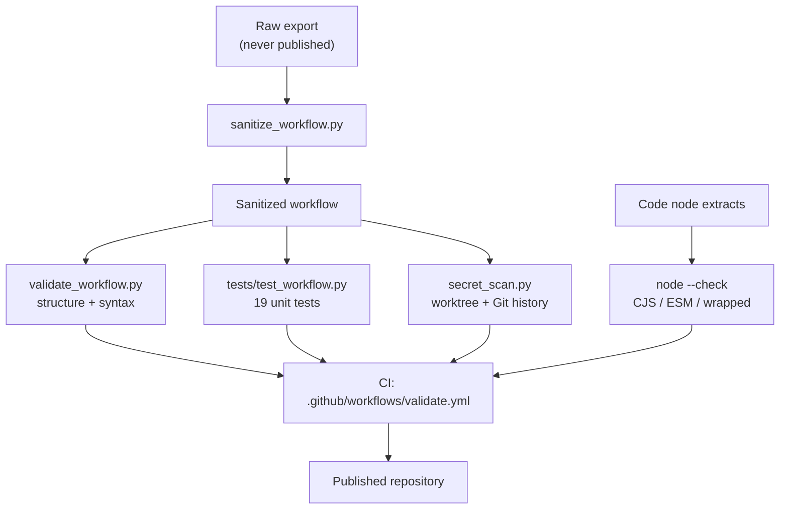

# 12 — Testing and Validation

| Item | Value |
|---|---|
| Document | Validation strategy, executed checks and results |
| Version | 1.0 |
| Date | 2026-11-10 |
| Toolchain | Python 3.12.10, Node.js v24.21.0, npm 11.19.0, git 2.55.0 |

---

## 1. Honesty statement

**No live n8n execution was performed.** The workflow was not triggered, no alert was
sent to the production webhook, no POST was sent to `/api/triage`, and no provider
credential was used. The results below are from static validation of the sanitized
export and from unit tests written for this repository. They are reproducible with the
commands in this document.

Runtime behaviour that remains unverified is listed in
[15 — Limitations](15-limitations-and-roadmap.md) (U1–U10).

---

## 2. Validation layers



| Layer | Script | Purpose |
|---|---|---|
| Sanitisation | `scripts/sanitize_workflow.py` | Remove secrets and instance metadata; verify no original secret survives |
| Structure | `scripts/validate_workflow.py` | Node/edge counts, unique names, connection targets, metadata hygiene, placeholders, Code node syntax |
| Unit tests | `tests/test_workflow.py` | Static assertions about structure, placeholders, samples and the sanitisation report |
| Secret scan | `scripts/secret_scan.py` | Credential-pattern scan of tracked files and optionally Git history |
| CI | `.github/workflows/validate.yml` | Runs all of the above on push/PR |

---

## 3. Commands

```bash
# Regenerate the sanitized export from the raw export (raw file is never published)
python scripts/sanitize_workflow.py \
  --source /secure/path/raw-export.json \
  --output workflows/enterprise-soc-soar-pipeline.sanitized.json \
  --report docs/sanitization-report.json

# Structural and Code node syntax validation
python scripts/validate_workflow.py \
  --workflow workflows/enterprise-soc-soar-pipeline.sanitized.json

# Secret scan of the working tree
python scripts/secret_scan.py --root .

# Secret scan including Git history (run after a commit exists)
python scripts/secret_scan.py --root . --history

# Unit tests
python -m unittest discover -s tests -v
```

`validate_workflow.py` requires Node.js on `PATH`. Set `NODE_BINARY` if `node` is not
the correct executable. Use `--skip-node-check` for a structure-only run.

---

## 4. What `validate_workflow.py` checks

| # | Check | Expected |
|---|---|---|
| 1 | `workflow.active` | `false` |
| 2 | `id`, `versionId`, `meta.instanceId`, `settings.errorWorkflow` | absent |
| 3 | Node count | 31 |
| 4 | Connection count | 36 |
| 5 | Unique node names and IDs | yes |
| 6 | Every connection source and target exists | yes |
| 7 | All 31 required node names present | yes |
| 8 | Credential IDs and `webhookId` | absent |
| 9 | Forbidden infrastructure literals | absent |
| 10 | Credential-like regex patterns | absent (placeholders ignored) |
| 11 | `REPLACE_WITH` placeholders | ≥ 10 |
| 12 | Code nodes | 13, each with non-empty `jsCode` |
| 13 | Code node syntax (CommonJS) | reported |
| 14 | Code node syntax (ES module) | reported |
| 15 | Code node syntax (wrapped in `async function`) | 13/13 pass — authoritative |

### Why three syntax checks

n8n Code node source is wrapped in a function context, so it can legally contain a
top-level `return`. A plain Node.js CommonJS file also allows a top-level `return`,
but rejects top-level `await`. An ES module allows top-level `await` but rejects a
top-level `return`. The **wrapped** check places the source inside
`async function __n8n_check() { ... }`, which is the closest approximation of the n8n
runtime and accepts both constructs.

The script therefore reports:

- `syntax_cjs_ok` — 12/13 (the Laya node fails with `await is only valid in async
  functions and the top level bodies of modules` at line 64).
- `syntax_esm_ok` — 0/13 (all Code nodes use top-level `return`, which is illegal in a
  module).
- `syntax_wrapped_ok` — 13/13, the authoritative result.

This is a **syntax** check only. It does not prove the Code node runs in n8n, and it does
not emulate the n8n sandbox (which is why C-02 remains a functional finding).

---

## 5. What `secret_scan.py` checks

| Pattern | Example source risk |
|---|---|
| Slack token | `xox*-*` tokens |
| Discord webhook | `discord.com/api/webhooks/<id>/<token>` |
| Telegram bot token | `<id>:<secret>` |
| GitHub token | `gh[pousr]_*` |
| AWS access key | `AKIA*` |
| Private key header | PEM private key |
| Bearer token | `Bearer <token>` |
| 64-character hex | API keys / hashes used as secrets |

Deliberate placeholders containing `REPLACE_WITH` or `REDACTED` are ignored. Matches are
**masked** to the first four and last two characters; the scanner never prints a full
secret. Binary files, `.git`, `node_modules`, virtualenvs and `.env*` files (except
`.env.example`) are skipped. `docs/sanitization-report.json` is excluded from the
64-hex check because it contains legitimate SHA-256 digests.

`--history` runs `git log -p --all` and scans the diff text.

---

## 6. Executed verification log

These are the **actual results** recorded during this audit.

### 6.1 Sanitisation

```text
nodes=31 edges=36
original_secret_count=13
surviving_original_secrets=0
unredacted_pattern_findings=0
```

Report: `docs/sanitization-report.json`.

### 6.2 Structural and syntax validation

```text
nodes=31 edges=36
placeholders=17
code_nodes=13
syntax_cjs_ok=12/13
syntax_esm_ok=0/13
syntax_wrapped_ok=13/13
  note: Laya Decision Gate uses n8n wrapper syntax (line 64: top-level await)
VALIDATION=PASS
```

### 6.3 Code extracts, `node --check` (CommonJS)

```text
OK   01-Final-Report.js          OK   02-Severity.js
OK   03-Incident-Summary.js      OK   04-TI-Aggregator.js
OK   05-TI-Normalizer.js         OK   06-IOC-Extraction.js
OK   07-Internal-Analysis.js     OK   08-Internal-Incident.js
OK   09-Dedup-Check.js           OK   10-TI-Corroboration-Scoring.js
OK   11-External-Incident.js     OK   12-IOC-Routing.js
FAIL 13-Laya-Decision-Gate.js    SyntaxError: await is only valid in async
                                 functions and the top level bodies of modules
```

The single failure is a portability warning, not proof of an n8n error; the wrapped
check passes.

### 6.4 Secret scan

```text
files_scanned=38
findings=0
```

(The first scan ran before `docs/README.md` was added and reported 35 files; the final
full-tree scan reports 38 files, still with zero findings.)

### 6.4b Git history secret scan

Run after the initial commit:

```text
files_scanned=38
git_history_scanned=yes
findings=0
```

The scanner splits `git log -p` into per-file blocks so that the legitimate SHA-256
digests in `docs/sanitization-report.json` are excluded from the 64-hex check, exactly
as in the worktree scan.

### 6.5 Unit tests

```text
Ran 19 tests in 6.844s
OK
```

| Test group | Tests |
|---|---|
| `WorkflowStructureTests` | 6 |
| `SanitizationTests` | 6 |
| `CodeNodeTests` | 3 |
| `SampleTests` | 3 |

One test (`test_known_dead_ends_are_documented`) was corrected during validation: the
`Is Public IP?` node represents its unconnected false output as an **empty array**, not
a missing array. The test now asserts the documented shape.

### 6.6 Read-only service probes

| Probe | Result |
|---|---|
| Laya console | HTTP 200, title `Laya - SOC Decision Console` |
| `GET /api/health` | HTTP 200, engine v6.2, model `convaiinnovations/laya`, online |
| `GET /api/stats` | HTTP 200, aggregate counters only |
| `GET /api/triage` | 404 |
| `OPTIONS` / `HEAD /api/triage` | 501 |
| `POST /api/triage` | **Not sent** |
| n8n editor | SPA shell only; REST/API returned 401 |
| GitHub repo existence | HTTP 404 at time of audit |

No credentials were used and no write operation was performed.

---

## 7. Static test matrix

| ID | Assertion | Result |
|---|---|---|
| S1 | 31 nodes, 36 edges | Pass |
| S2 | All 31 expected node names present | Pass |
| S3 | No duplicate names or IDs | Pass |
| S4 | Every connection target resolves | Pass |
| S5 | Workflow inactive; no instance metadata | Pass |
| S6 | No credential IDs or `webhookId` | Pass |
| S7 | Eight provider/integration header placeholders present | Pass |
| S8 | Discord URL and Telegram chat ID placeholders present | Pass |
| S9 | No forbidden infrastructure literals | Pass |
| S10 | Sanitisation report: 0 survivors, 0 findings | Pass |
| S11 | 13 Code nodes with non-empty source | Pass |
| S12 | Wrapped syntax check 13/13 | Pass |
| S13 | Laya Code node has no `hermes` or `hmac` string | Pass |
| S14 | Sample files valid JSON, documentation IPs only | Pass |
| S15 | Secret scan: 0 findings | Pass |

---

## 8. Proposed runtime tests (not executed)

These require a non-production n8n instance and mocked external services. They are
**planned**, not results.

| ID | Test | Expected |
|---|---|---|
| R1 | POST synthetic alert to authenticated webhook | 202/200, one execution |
| R2 | Same alert within 3 minutes | Suppressed with a recorded suppression event |
| R3 | External alert with mocked malicious TI | CRITICAL, `TRUE_POSITIVE_THREAT`, risk ≥80 |
| R4 | Internal level-10 alert | HIGH, `INTERNAL_SECURITY_EVENT` (after H-03 fix) |
| R5 | Alert with missing `source_ip` | Valid IRIS payload, no `ReferenceError` (after C-03 fix) |
| R6 | ThreatFox `invalid_auth_key` response | No CRITICAL escalation (after H-05 fix) |
| R7 | Hash-only alert | VT `/files/{hash}` and ThreatFox hash search used (after H-06 fix) |
| R8 | Laya engine reachable | Real decision returned and recorded |
| R9 | Laya engine unreachable | Visible `ENGINE_UNAVAILABLE` alert, no silent flood |
| R10 | CRITICAL public IP | One IRIS case, three chat messages, one verified deny policy |
| R11 | MEDIUM incident | Explicit "no containment required" record |
| R12 | Private IP | Explicit "no containment" record; no FortiGate call |
| R13 | Provider 401 / 429 / 5xx | `unavailable` status, named provider failure, no severity escalation |
| R14 | Notification failure | Error branch records the failure |
| R15 | Invalid/oversized payload | Rejected at schema validation, no provider calls |
| R16 | 1,000-alert burst | Bounded by rate limit and budget guard |
| R17 | `git log -p` scan | 0 credential findings |

---

## 9. Regression coverage for findings

Every finding in [16 — Audit report](16-audit-report.md) should eventually have a
regression test. Priority mapping:

| Finding severity | Regression tests |
|---|---|
| Critical (4) | R1, R5, R8, R9, R15, R17 |
| High (8) | R2, R3, R4, R6, R7, R10, R11, R12, R13, R14 |
| Medium (9) | R3, R6, R7, R13, R16 |
| Low (6) | Output-escaping and metrics tests |

---

## 10. CI behaviour

`.github/workflows/validate.yml` runs on push, pull request and manual dispatch:

1. `actions/checkout@v4`
2. `actions/setup-python@v5` (3.12)
3. `actions/setup-node@v4` (20)
4. `validate_workflow.py`
5. `secret_scan.py --root .`
6. `secret_scan.py --root . --history`
7. `python -m unittest discover -s tests -v`
8. JSON parse of `workflows/samples/*.json`

Permissions are limited to `contents: read`. No secrets are required by the workflow.

---

## 11. Known gaps in the validation suite

| Gap | Reason |
|---|---|
| No workflow execution | The audit was read-only |
| No provider response fixtures | Real responses not available; only synthetic samples |
| No load/performance test | Requires a non-production environment |
| No HMAC test | HMAC is not implemented in this export |
| No screenshot comparison | No authenticated screenshots available |
| No Code node lint | No linter configured in the original workflow |
| No Merge-runtime test | Requires the deployed n8n version (U1) |

Adding these is part of Phase 3 of the roadmap in
[15 — Limitations and roadmap](15-limitations-and-roadmap.md).

---

## 12. Related documents

- [04 — Code audit](04-code-audit.md)
- [11 — Installation](11-installation.md)
- [14 — Security](14-security.md)
- [15 — Limitations and roadmap](15-limitations-and-roadmap.md)
- [16 — Audit report](16-audit-report.md)
