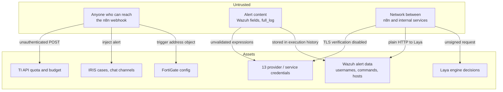

# 14 — Security Considerations

| Item | Value |
|---|---|
| Document | Security review and hardening guidance |
| Version | 1.0 |
| Date | 2026-11-10 |
| Basis | Static audit of the raw export, sanitised workflow, read-only service probes |

---

## 1. Security posture summary

| Area | Status |
|---|---|
| Secrets in raw export | **13 exposed values** — must be rotated |
| Secrets in published repository | None; placeholders only |
| Inbound webhook authentication | **Absent** |
| Inbound rate limiting / size limit / schema validation | **Absent** |
| Laya engine authentication | **Absent** (no HMAC observed or implemented) |
| TLS verification for IRIS and FortiGate | **Explicitly disabled** |
| Execution-data retention | Not configured in the export |
| Error workflow | Referenced but not exported |
| Notification failure visibility | Suppressed by `continueRegularOutput` |
| Containment | Not implemented (address object only) |

The sanitized repository is safe to store privately. The **original export is not safe to
share** and the credentials in it must be treated as compromised.

---

## 2. Threat model



### Trust boundaries

| # | Boundary | Risk |
|---|---|---|
| B1 | Internet/Wazuh → n8n webhook | No auth, no allowlist, no rate limit, no schema check |
| B2 | Alert data → outbound HTTP expressions | Unvalidated values inserted into URLs and JSON strings |
| B3 | n8n → TI SaaS | Six long-lived API keys, originally inline |
| B4 | n8n → Laya engine | Plain HTTP, no authentication, no replay protection |
| B5 | n8n → IRIS / FortiGate | Bearer tokens with TLS verification disabled |
| B6 | n8n → chat platforms | Webhook URL and bot tokens; delivery failures hidden |
| B7 | n8n execution history | Full Wazuh payloads retained by default |

---

## 3. Secret exposure and rotation

### 3.1 What was in the raw export

| # | Category | Count |
|---|---|---:|
| 1 | Threat-intelligence API keys (VirusTotal, AbuseIPDB, OTX, GreyNoise, ThreatFox, LeakIX) | 6 |
| 2 | Bearer tokens (FortiGate, DFIR-IRIS) | 2 |
| 3 | Discord webhook URL | 1 |
| 4 | Telegram chat ID | 1 |
| 5 | Workflow-level identifiers (`versionId`, `meta.instanceId`, `settings.errorWorkflow`) | 3 |

Total tracked values replaced or removed by the sanitizer: **13**. In addition, the
sanitizer removed three infrastructure addresses, all credential IDs, all `webhookId`
values and the workflow `id`. The sanitizer verified `surviving_original_secrets: 0`
and `unredacted_pattern_findings: 0`.

### 3.2 Rotation is mandatory

**Sanitisation does not un-leak a credential.** A value that existed in a file, a
screenshot, a backup, a chat or a Git object remains exposed until it is revoked at the
provider.

Rotation procedure:

1. Revoke or regenerate each value at its provider. Use a dedicated service account per
   integration.
2. Review provider audit logs for unexpected usage.
3. Review n8n execution history and reverse-proxy logs for unexpected outbound calls.
4. Replace inline header values with n8n Header Auth credentials or environment-bound
   expressions.
5. Remove the value from every copy: exports, YAML copies, screenshots, tickets and chat
   logs.
6. Record the rotation date, the integration and the new credential ID (not the value).
7. Re-run `python scripts/secret_scan.py --root . --history`.

### 3.3 Git history

The repository is initialised fresh with only sanitized files. Before pushing:

```bash
git status --short
git diff --cached --stat
python scripts/secret_scan.py --root . --history
```

If a secret was ever staged locally, do **not** simply delete it in a later commit — that
leaves it in history. Remove it from the working tree, rotate it, and only then consider
history rewriting. `SECURITY.md` documents the reporting path.

---

## 4. Inbound webhook security (B1)

Current state: `options: {}`, no authentication, no IP allowlist, no rate limit, no body
size limit, no schema validation.

| Control | Recommended implementation |
|---|---|
| Authentication | n8n webhook Header Auth / Basic / JWT verified at a reverse proxy, or mTLS between Wazuh and n8n |
| IP allowlist | Restrict to the Wazuh manager's address at the reverse proxy |
| Rate limiting | Per-source-IP token bucket; burst cap |
| Body size | Reject payloads above a configured limit |
| Schema validation | Require `body.rule.id`, numeric `body.rule.level` (0–15), `body.agent.name`; reject unknown top-level structures |
| Replay protection | HMAC signature with timestamp and nonce (see [09](09-hermes-ai-integration.md)) |
| TLS | HTTPS with a valid certificate; `authCookie.secure=true` in n8n settings |
| Response | Explicit `202 Accepted` to avoid upstream retries |

An unauthenticated caller can currently:

- inject arbitrary alerts and consume six paid TI calls per request,
- create IRIS cases and chat notifications,
- trigger FortiGate address-object attempts for HIGH/CRITICAL severities,
- bypass dedup by including `"test": true`,
- and cause `Final Report` to fail via the C-03 path by omitting `srcip`.

---

## 5. Injection and untrusted input (B2)

Alert-derived values are interpolated into:

| Location | Expression |
|---|---|
| VirusTotal URL | `{{$json.ioc.value}}` |
| OTX URL | `{{$json.source_ip}}` |
| GreyNoise URL | `{{$json.source_ip}}` |
| LeakIX URL | `{{$json.source_ip}}` |
| ThreatFox JSON body | `{{$json.source_ip}}` |
| AbuseIPDB query | `$json.ioc?.public_ips?.[0] ?? $json.source_ip` |
| FortiGate JSON body | `{{$json.report.source_ip}}`, `{{$json.report.severity}}` |
| Discord / Telegram / Slack messages | report fields |

Risks:

- **URL path/query manipulation.** An IOC containing `/`, `?`, `#` or `@` can alter the
  request path or query.
- **JSON injection.** FortiGate's body is assembled as a JSON *string*. A `source_ip`
  containing a quote can break the JSON or inject additional fields.
- **Markup injection.** Slack mrkdwn and Telegram HTML are not fully escaped; `@channel`
  or `<...>` sequences can change rendering or trigger mentions.
- **Prompt/decision manipulation.** The Laya payload includes `raw_alert`, `description`
  and `srcuser` verbatim. If the engine uses a model, untrusted text is passed to it.
- **Log injection.** Raw values appear in IRIS descriptions and chat messages.

Mitigations:

1. Validate `source_ip` with a strict IPv4/IPv6 parser before any provider call.
2. URL-encode path segments and use structured query/body parameters rather than string
   concatenation.
3. Build JSON bodies as objects, not strings.
4. Escape per output format (HTML, mrkdwn, JSON, plain text).
5. Truncate `full_log` and remove control characters.
6. Treat all alert text as data, never as instructions.

---

## 6. Transport security (B3, B4, B5, B6)

| Connection | Current | Risk | Target |
|---|---|---|---|
| Six TI providers | HTTPS, inline keys | Key leakage via export | HTTPS + n8n credentials |
| Laya `/api/triage` | Plain HTTP, no auth, full raw alert | Sniffing, spoofing, tampering, replay | HTTPS + HMAC + timeout + TLS verification |
| DFIR-IRIS | HTTPS with `allowUnauthorizedCerts: true` | Bearer token exposed to MITM | Valid certificate, verification enabled |
| FortiGate | HTTPS with `allowUnauthorizedCerts: true` | Bearer token exposed to MITM | Valid certificate, verification enabled |
| Discord / Telegram / Slack | Provider HTTPS + webhook/token | Webhook URL is a bearer credential | Rotate, store as credential, restrict channel |

`allowUnauthorizedCerts: true` on both internal integrations is a deliberate bypass of
certificate validation. It must be removed before production use.

---

## 7. Data protection and retention (B7)

Wazuh alerts can contain:

- usernames and account names,
- executed commands (including credentials in command lines),
- internal hostnames and IP addresses,
- file paths and hashes,
- raw log lines with PII.

These values flow into n8n execution data, the IRIS case, three chat platforms and the
Laya payload. No redaction occurs.

| Control | Recommendation |
|---|---|
| Execution retention | `EXECUTIONS_DATA_PRUNE=true`, `EXECUTIONS_DATA_MAX_AGE=168`, `EXECUTIONS_DATA_SAVE_ON_SUCCESS=none` |
| Log redaction | Redact tokens, command-line secrets and PII before chat/IRIS |
| Access control | Restrict n8n editor, IRIS, Laya console and chat channels to SOC staff |
| Data minimisation | Send only required fields to the Laya engine; avoid `raw_alert` unless needed |
| Retention documentation | State actual retention in n8n, IRIS, chat and engine settings |
| Deletion language | Do **not** claim forensic erasure; describe configured retention and cleanup |

The original user requirement said not to describe file deletion as guaranteed forensic
erasure. This repository documents placeholder-based sanitisation and Git hygiene, not
physical erasure.

---

## 8. Access control and least privilege

| System | Recommended permission |
|---|---|
| n8n | Editor access limited to SOC engineers; credentials visible only to admins |
| TI providers | Read-only API keys with the narrowest scope and per-key quotas |
| DFIR-IRIS | A service account that can create alerts but not modify cases globally |
| FortiGate | A dedicated API user restricted to the specific VDOM and address/policy operations |
| Discord | Incoming webhook for one channel only |
| Telegram | Bot restricted to one chat |
| Slack | `chat:write` for one channel only |
| Laya engine | Dedicated client key; no shared admin secret |

The FortiGate node currently has a broad bearer token embedded in the workflow. Creating
an address object is low impact, but the token itself may permit far more.

---

## 9. Error handling and availability security

| Issue | Security consequence |
|---|---|
| `continueRegularOutput` on all notification nodes | Silent delivery failures; analysts may believe a case was created |
| No error workflow exported | No global alerting on pipeline failure |
| No circuit breaker | Provider outage or malicious burst exhausts quota |
| Fail-safe escalates everything if Laya is down | Alert flood; IRIS and chat spam; possible auto-containment attempts |
| Retries on deterministic Code bugs | 3× duplicate log entries and latency |
| No idempotency on IRIS/FortiGate | Duplicate cases and repeated address-object attempts |

Add a dedicated error workflow, structured metrics (ingested, suppressed, escalated,
provider errors, notification failures) and an alert on sustained
`ENGINE_UNAVAILABLE`.

---

## 10. Supply chain and platform

| Item | Observation |
|---|---|
| n8n version | 2.40.5 in export metadata; `authCookie.secure=false` in raw settings |
| Custom/community nodes | None; all node types are built-in |
| Code dependencies | No npm imports in Code nodes; the Laya node relies on unsupported `fetch` |
| External libraries | None declared in the workflow |
| Node versions | Pinned per node (`typeVersion`), which is good for reproducibility |
| Engine | Laya `/api/health` reports engine v6.2, model `convaiinnovations/laya`; server header `Laya-Triage/5.1` |

Keep n8n patched, enable `authCookie.secure`, and avoid enabling external modules in Code
nodes unless required and reviewed.

---

## 11. Automated checks in this repository

| Script | Purpose |
|---|---|
| `scripts/sanitize_workflow.py` | Removes secrets and instance metadata; verifies 0 survivors |
| `scripts/validate_workflow.py` | Structural checks, placeholder checks, Code node syntax |
| `scripts/secret_scan.py` | Scans tracked files and optionally Git history for credential patterns |
| `.github/workflows/validate.yml` | Runs validation, secret scan and unit tests in CI |
| `tests/test_workflow.py` | Unit tests for structure, placeholders and samples |

The scanner masks any match it prints; it never prints a full secret value. Patterns
include Slack tokens, Discord webhooks, Telegram bot tokens, generic bearer tokens,
GitHub/AWS tokens, private keys and long hex strings. Placeholders containing
`REPLACE_WITH` or `REDACTED` are ignored deliberately.

---

## 12. Prioritised hardening plan

| Priority | Action |
|---|---|
| P0 | Rotate the 13 exposed values; remove all inline credentials |
| P0 | Authenticate the webhook; add IP allowlist, rate limit, size limit, schema validation |
| P0 | Fix `Final Report` `ReferenceError` (C-03) |
| P0 | Move the Laya call to an HTTP Request node (C-02) and sign it once the engine contract is known |
| P1 | Enable TLS verification on IRIS and FortiGate |
| P1 | Implement real containment with approval and rollback (H-01) |
| P1 | Connect dead-end branches and add explicit closure records (H-02) |
| P1 | Consolidate severity and fix ThreatFox status handling (H-03, H-05) |
| P1 | Enable execution-data pruning and redact alert bodies |
| P2 | Add an error workflow, metrics, budget guards and provider caching |
| P2 | Add per-format output escaping and structured body builders |
| P2 | Add automated regression tests for every finding in [16](16-audit-report.md) |

---

## 13. Reporting

See `SECURITY.md`. Do not open a public issue for a suspected leak. Contact the
maintainer privately with the affected file, commit ID and a redacted reproduction. Never
include a live credential in the report.

---

## 14. Related documents

- `SECURITY.md`
- `docs/sanitization-report.json`
- [09 — Hermes AI integration](09-hermes-ai-integration.md)
- [11 — Installation](11-installation.md)
- [12 — Testing and validation](12-testing-and-validation.md)
- [16 — Audit report](16-audit-report.md)
